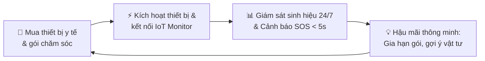
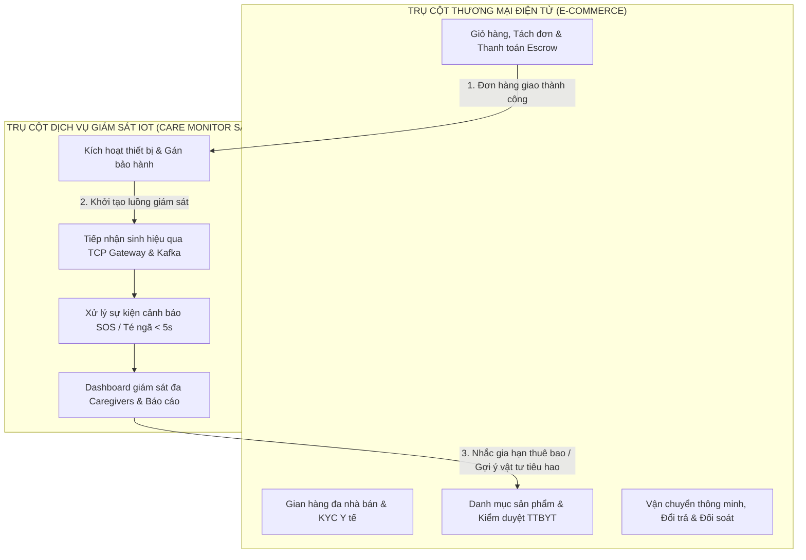
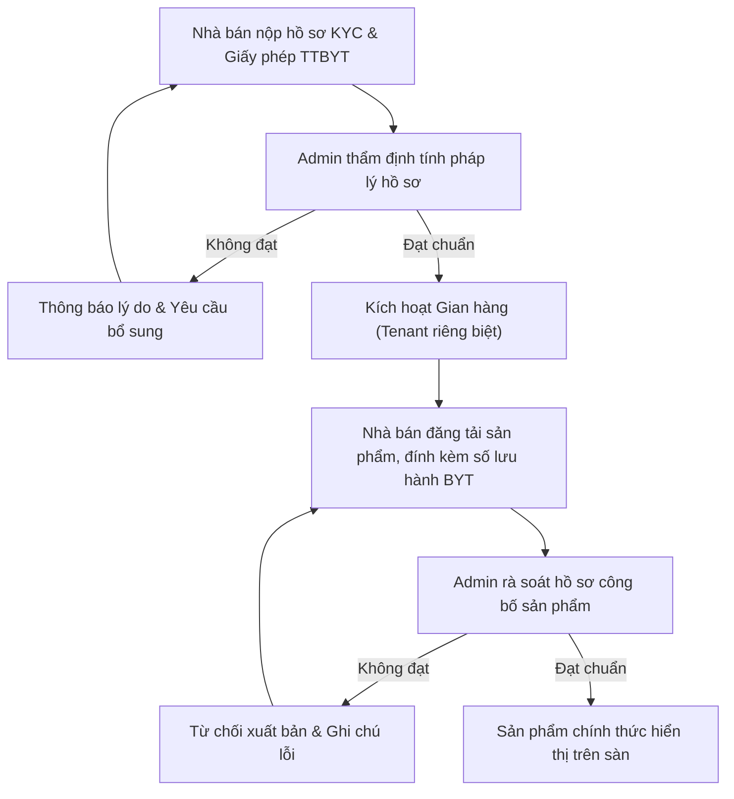
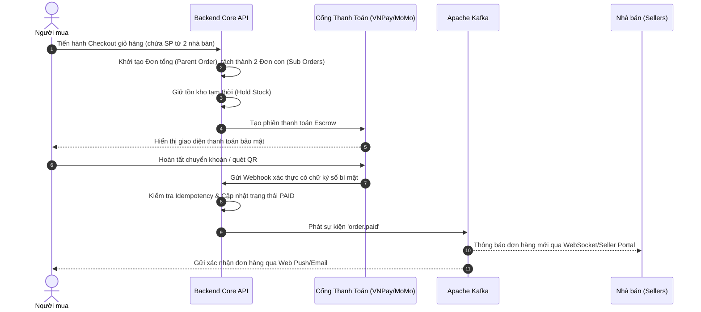
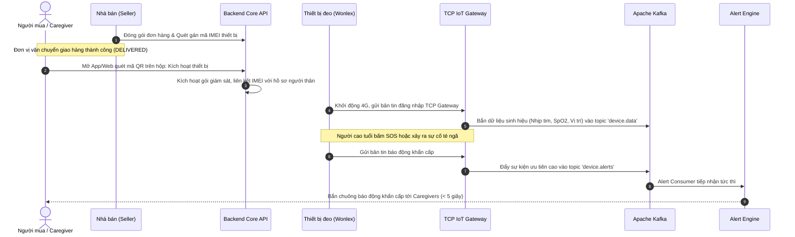
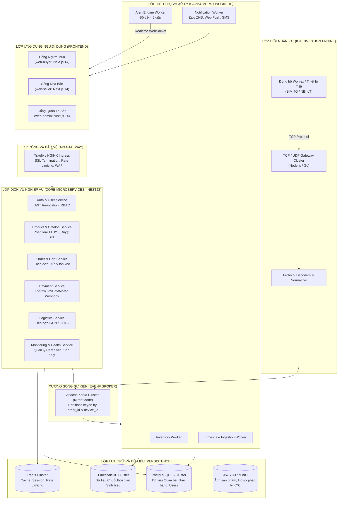
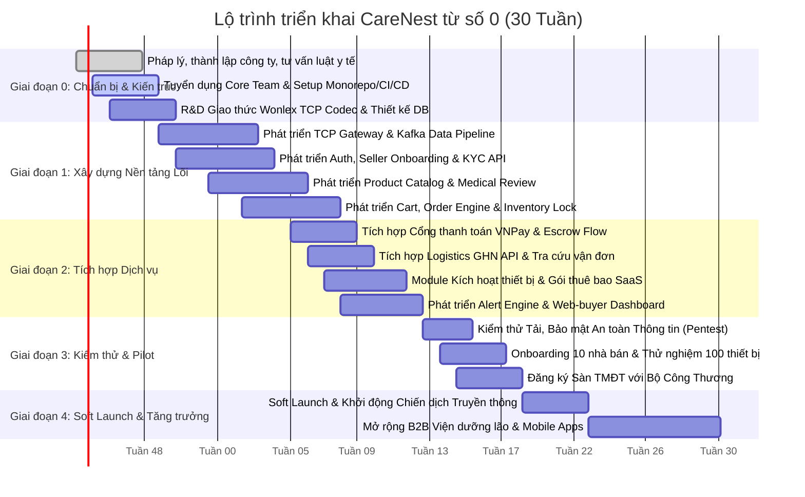

# ĐỀ XUẤT Ý TƯỞNG DỰ ÁN
## CARENEST – SÀN THƯƠNG MẠI ĐIỆN TỬ Y TẾ GẮN VỚI DỊCH VỤ CHĂM SÓC TỪ XA

> **CareNest**: *“Buy right. Care always.”* (Mua đúng thiết bị, chăm sóc liên tục).  
> **Định vị:** Sàn thương mại điện tử chuyên biệt về thiết bị, vật tư và giải pháp y tế (Multi-vendor B2B2C), tích hợp nền tảng giám sát sức khỏe từ xa và cảnh báo khẩn cấp thời gian thực (IoT Health SaaS).  
> **Định hướng phát triển:** **Xây dựng mới toàn diện từ con số 0 (Zero-base Engineering)** — tự chủ 100% công nghệ lõi cả về sàn TMĐT lẫn hệ sinh thái IoT Gateway.

---

## MỤC LỤC

1. [Tóm tắt ý tưởng](#1-tóm-tắt-ý-tưởng)
2. [Bối cảnh và vấn đề](#2-bối-cảnh-và-vấn-đề)
3. [Hiện trạng và định hướng: Xây dựng từ con số 0](#3-hiện-trạng-và-định-hướng-xây-dựng-từ-con-số-0)
4. [Giải pháp đề xuất](#4-giải-pháp-đề-xuất)
5. [Đối tượng tham gia và giá trị mang lại](#5-đối-tượng-tham-gia-và-giá-trị-mang-lại)
6. [Danh mục sản phẩm và dịch vụ](#6-danh-mục-sản-phẩm-và-dịch-vụ)
7. [Tính năng chính của nền tảng](#7-tính-năng-chính-của-nền-tảng)
8. [Các luồng nghiệp vụ chính](#8-các-luồng-nghiệp-vụ-chính)
9. [Mô hình kinh doanh](#9-mô-hình-kinh-doanh)
10. [Kiến trúc kỹ thuật xây mới](#10-kiến-trúc-kỹ-thuật-xây-mới)
11. [Pháp lý và tuân thủ](#11-pháp-lý-và-tuân-thủ)
12. [Phân tích cạnh tranh](#12-phân-tích-cạnh-tranh)
13. [Phạm vi MVP và lộ trình triển khai](#13-phạm-vi-mvp-và-lộ-trình-triển-khai)
14. [Chỉ số đo lường thành công](#14-chỉ-số-đo-lường-thành-công)
15. [Rủi ro và phương án giảm thiểu](#15-rủi-ro-và-phương-án-giảm-thiểu)
16. [Kết luận và kế hoạch hành động 30 ngày đầu](#16-kết-luận-và-kế-hoạch-hành-động-30-ngày-đầu)

---

## 1. Tóm tắt ý tưởng

**CareNest** là sàn thương mại điện tử chuyên ngành y tế đa nhà bán (multi-vendor, B2B2C), tập trung vào sản phẩm, thiết bị y tế và dịch vụ chăm sóc sức khỏe cho **người cao tuổi, người bệnh mạn tính và gia đình có nhu cầu chăm sóc người thân**.

Khác biệt hoàn toàn với các sàn thương mại điện tử tổng hợp thông thường (nơi giao dịch chấm dứt ngay sau khi giao hàng thành công), CareNest tạo ra một hệ sinh thái chăm sóc liên tục:
- Khách hàng mua thiết bị y tế (như đồng hồ định vị theo dõi sinh hiệu Wonlex, máy đo huyết áp, máy đo SpO2 Bluetooth/4G).
- Sau khi nhận hàng, thiết bị được **kích hoạt trực tiếp trên hệ thống giám sát sức khỏe từ xa CareNest Monitor** do CareNest tự phát triển.
- Dữ liệu sinh hiệu, vị trí và cảnh báo tức thời (SOS, té ngã, rối loạn nhịp tim) được truyền trực tiếp đến người chăm sóc (caregiver) và gia đình với độ trễ dưới 5 giây.
- Dựa trên dữ liệu giám sát sức khỏe thực tế, hệ thống chủ động hỗ trợ người dùng: nhắc lịch bảo dưỡng thiết bị, nhắc thay que thử/vật tư tiêu hao, nhắc gia hạn dịch vụ và đưa ra gợi ý sản phẩm phù hợp.



**Ý tưởng cốt lõi trong một câu:** *“Buy right. Care always — Mua đúng thiết bị y tế chính hãng, nhận dịch vụ chăm sóc và bảo vệ sức khỏe liên tục suốt vòng đời.”*

---

## 2. Bối cảnh và vấn đề

### 2.1. Bối cảnh thị trường

- **Già hóa dân số nhanh:** Việt Nam là một trong những quốc gia có tốc độ già hóa dân số nhanh nhất thế giới. Đến năm 2036, Việt Nam sẽ bước vào thời kỳ dân số già với hơn 16 triệu người cao tuổi, nhu cầu về thiết bị theo dõi y tế tại nhà, vật tư chăm sóc và dịch vụ hỗ trợ sinh hoạt tăng trưởng đột biến.
- **Mô hình gia đình hiện đại:** Con cái thường đi làm xa hoặc không sống cùng nhà với cha mẹ già, tạo ra nhu cầu cấp bách về một giải pháp giám sát an toàn và sức khỏe người thân từ xa một cách tự động, đáng tin cậy.
- **Rào cản niềm tin trên sàn TMĐT tổng hợp:** Người tiêu dùng rất e ngại khi mua thiết bị y tế trên các sàn TMĐT thông thường do vấn nạn hàng giả, hàng xách tay không giấy phép kiểm định, thiếu hướng dẫn chuyên môn và hoàn toàn không có hỗ trợ kỹ thuật sau bán.

### 2.2. Vấn đề cần giải quyết cho từng bên tham gia

| Đối tượng | Vấn đề nan giải hiện tại | Cơ hội giải quyết của CareNest |
|:--|:--|:--|
| **Người mua & Gia đình** | • Rất khó phân biệt thiết bị y tế chính hãng đạt chuẩn Bộ Y tế.<br/>• Mua thiết bị về không biết cài đặt, kích hoạt hay sử dụng.<br/>• Dữ liệu đo đạc rời rạc, không ai giám sát liên tục. | • Cam kết 100% chính hãng, có giấy phép công bố TTBYT.<br/>• Trải nghiệm kích hoạt 1 chạm, hỗ trợ hotline tận tâm.<br/>• Giám sát liên tục 24/7, cảnh báo trực tiếp về điện thoại người thân. |
| **Người chăm sóc (Caregivers)** | • Lo lắng thường trực khi cha mẹ ở nhà một mình.<br/>• Không hay biết khi người thân bị té ngã hoặc đột quỵ kịp thời. | • Cảnh báo té ngã, SOS, nhịp tim bất thường đến đa người thân trong vòng < 5 giây.<br/>• Xem định vị và báo cáo sức khỏe hàng ngày trên dashboard. |
| **Nhà bán thiết bị y tế (Sellers)** | • Phải cạnh tranh về giá với hàng lậu/hàng giả trên sàn tổng hợp.<br/>• Mối quan hệ với khách hàng bị đứt gãy ngay sau khi giao hàng.<br/>• Không có công cụ bán dịch vụ bảo dưỡng, vật tư định kỳ. | • Môi trường kinh doanh uy tín chuyên biệt cho y tế, bảo vệ giá.<br/>• Giữ chân khách hàng trọn đời thông qua gói dịch vụ đi kèm thiết bị.<br/>• Doanh thu định kỳ chia sẻ từ thuê bao giám sát (recurring revenue). |
| **Viện dưỡng lão & Cơ sở y tế** | • Mua sắm thiết bị rời rạc từ nhiều nguồn.<br/>• Theo dõi người cao tuổi tại phòng bằng phương pháp ghi chép thủ công. | • Đặt hàng B2B số lượng lớn với chiết khấu minh bạch.<br/>• Nền tảng quản lý tập trung hàng trăm thiết bị cùng lúc trên dashboard y tế. |

---

## 3. Hiện trạng và định hướng:

Khác với định hướng ban đầu từng xem xét việc kế thừa module phần mềm có sẵn, dự án **CareNest được xác lập lại với định hướng: Phát triển toàn diện từ con số 0 (Zero-base Build)**. Toàn bộ nền tảng — từ lớp lõi thương mại điện tử đa nhà bán cho đến hạ tầng tiếp nhận dữ liệu IoT và công cụ cảnh báo khẩn cấp — đều được phân tích, thiết kế và lập trình mới hoàn toàn.

### 3.1. Các khối thành phần hệ sinh thái cần xây mới

1. **Hạ tầng IoT Gateway & Thiết bị (IoT Core):**
   - Xây mới TCP/UDP/MQTT Gateway để tiếp nhận kết nối trực tiếp từ đồng hồ định vị/vòng đeo tay Wonlex và các thiết bị y tế thông minh qua sóng 4G/NB-IoT.
   - Xây dựng bộ giải mã giao thức (Protocol Codecs) độc lập, xử lý gói tin định vị GPS, gói tin nhịp tim, huyết áp, SpO2, cảnh báo SOS và phát hiện té ngã.
   - Quản lý vòng đời thiết bị (Device Registry): Đăng ký IMEI/Device ID, gán nhà bán, kích hoạt bảo hành điện tử và liên kết tài khoản gia đình.

2. **Hạ tầng Xử lý Dữ liệu Sức khỏe & Cảnh báo Tức thời (Data & Alert Engine):**
   - Thiết lập cụm Apache Kafka (KRaft mode) làm xương sống điều phối luồng dữ liệu (Event Broker) cho cả sự kiện thương mại và sự kiện sức khỏe.
   - Tích hợp TimescaleDB trên nền PostgreSQL để tối ưu hóa lưu trữ và truy vấn chuỗi thời gian (time-series data) hàng triệu bản ghi sinh hiệu mỗi ngày.
   - Xây dựng Alert Engine xử lý song song, bảo đảm chuyển tiếp cảnh báo khẩn cấp đến gia đình (Web Push, Socket.IO, Zalo ZNS, SMS) trong thời gian dưới 5 giây.

3. **Sàn Thương mại Điện tử Đa nhà bán (Multi-vendor E-commerce Core):**
   - Xây mới kiến trúc Multi-tenant: Tách biệt dữ liệu quản lý, kho hàng, tài chính và phân quyền giữa các nhà bán hàng (Sellers).
   - Module Danh mục & Kiểm duyệt y tế: Quản lý SKU, phân loại trang thiết bị y tế (Loại A, B, C, D), lưu trữ số công bố/giấy phép lưu hành Bộ Y tế.
   - Module Giỏ hàng & Tách đơn tự động: Hỗ trợ người mua gom đơn từ nhiều nhà bán trong một lần thanh toán; hệ thống tự động tách đơn con cho từng gian hàng.
   - Tích hợp Cổng thanh toán & Cơ chế Tạm giữ (Escrow): Hợp tác với VNPay/MoMo/ZaloPay; áp dụng luồng thanh toán an toàn, bảo vệ người mua y tế.
   - Tích hợp Đơn vị Vận chuyển: Kết nối API Giao Hàng Nhanh (GHN) / GHTK để tính phí tự động, theo dõi vận đơn và kiểm soát giao nhận sản phẩm nhạy cảm.

4. **Bộ ba Giao diện Ứng dụng (Frontend Portals):**
   - **Cổng Người mua (Web-buyer):** Trải nghiệm mua sắm mượt mà, tra cứu hồ sơ pháp lý sản phẩm, kích hoạt thiết bị 1-click và Dashboard theo dõi sức khỏe người thân.
   - **Cổng Nhà bán (Web-seller):** Quản lý hồ sơ KYC, đăng bán sản phẩm kèm chứng chỉ y tế, quản lý kho IMEI thiết bị, xử lý đơn hàng và đối soát doanh thu.
   - **Cổng Quản trị sàn (Web-admin):** Thẩm định hồ sơ nhà bán, kiểm duyệt sản phẩm trước khi xuất bản, giám sát sức khỏe hạ tầng, xử lý khiếu nại và tra cứu audit log.

### 3.2. Cơ hội và Thách thức khi xây mới từ số 0

```
┌────────────────────────────────────────────────────────────────────────┐
│                   CHIẾN LƯỢC XÂY MỚI TỪ CON SỐ 0                       │
├───────────────────────────────────┬────────────────────────────────────┤
│  LỢI THẾ CẠNH TRANH DÀI HẠN       │  THÁCH THỨC VÀ BIỆN PHÁP ỨNG PHÓ   │
├───────────────────────────────────┼────────────────────────────────────┤
│ • Không nợ kỹ thuật (Zero Legacy):│ • Khối lượng công việc lớn:        │
│   Thiết kế kiến trúc sạch (Clean   │   Áp dụng phương pháp Agile/Scrum, │
│   Architecture, DDD) ngay từ đầu. │   chia nhỏ thành các Sprint 2 tuần;│
│ • Kiểm soát bảo mật dữ liệu y tế: │   ưu tiên hoàn thiện lõi MVP trước.│
│   Tuân thủ triệt để Nghị định     │ • Chi phí đầu tư ban đầu cao hơn:  │
│   13/2023/NĐ-CP về bảo vệ dữ liệu │   Dự toán vốn Year 1 từ 7–10 tỷ VNĐ│
│   cá nhân và dữ liệu sức khỏe.    │   (so với ~5 tỷ nếu có sẵn khung). │
│ • Độ linh hoạt tối đa:            │ • Thời gian đến khi ra mắt (T2M):  │
│   Không bị trói buộc vào một hãng │   Kế hoạch 30 tuần (~7.5 tháng)    │
│   thiết bị cụ thể; kiến trúc mở   │   được kiểm soát chặt chẽ theo     │
│   cho phép cắm rút nhiều dòng IoT.│   từng cột mốc bàn giao cụ thể.    │
└───────────────────────────────────┴────────────────────────────────────┘
```

---

## 4. Giải pháp đề xuất

CareNest kết hợp chặt chẽ giữa hai trụ cột nghiệp vụ trên một hạ tầng công nghệ thống nhất:



### Điểm khác biệt mang tính đột phá của CareNest:

1. **Sàn TMĐT chuẩn y tế nghiêm ngặt:** 100% nhà bán phải có giấy chứng nhận đủ điều kiện kinh doanh TTBYT do Sở Y tế cấp; 100% sản phẩm có hồ sơ công bố/lưu hành rõ ràng.
2. **Mô hình Hybrid Revenue:** Không chỉ thu hoa hồng trên từng đơn hàng bán lẻ (8–15%), sàn còn sở hữu dòng tiền đều đặn từ thuê bao dịch vụ giám sát sức khỏe hàng tháng/năm.
3. **Chăm sóc dựa trên dữ liệu thời gian thực:** Tạo lý do tự nhiên và chính đáng để khách hàng quay lại mua sắm định kỳ (que thử đường huyết, pin thay thế, gói giám sát nâng cao, tã người lớn).
4. **Hệ sinh thái bảo vệ gia đình:** Cơ chế phân quyền Caregiver và Co-caregivers cho phép nhiều người con cùng lúc theo dõi cha mẹ, chia sẻ gánh nặng chăm sóc.

---

## 5. Đối tượng tham gia và giá trị mang lại

| Đối tượng | Vai trò chính | Giá trị khác biệt nhận được |
|:--|:--|:--|
| **Khách hàng cá nhân & Gia đình** | Mua thiết bị theo dõi, vật tư y tế, gói dịch vụ chăm sóc cho người thân. | Yên tâm tuyệt đối về chất lượng chính hãng; được hỗ trợ cài đặt tận tình; nhận cảnh báo an nguy của cha mẹ mọi lúc mọi nơi. |
| **Người chăm sóc (Caregivers)** | Giám sát chỉ số sinh hiệu, vị trí và xử lý cảnh báo của người thân. | Cảnh báo khẩn cấp dưới 5 giây; nắm bắt xu hướng sức khỏe qua báo cáo định kỳ; giảm bớt áp lực tâm lý khi ở xa. |
| **Nhà bán thiết bị y tế (Sellers)** | Phân phối thiết bị, vật tư và cung cấp gói bảo hành/dịch vụ trên sàn. | Tiếp cận tệp khách hàng có nhu cầu y tế thực sự; bảo vệ uy tín thương hiệu; hưởng thêm dòng doanh thu định kỳ từ thuê bao dịch vụ. |
| **Viện dưỡng lão & Phòng khám (B2B)** | Mua số lượng lớn, trang bị thiết bị giám sát tập trung cho bệnh nhân/cư dân. | Chính sách chiết khấu B2B hấp dẫn; phần mềm giám sát đa phòng bệnh tập trung; số hóa quy trình quản lý cư dân cao tuổi. |
| **Đội ngũ Vận hành Sàn** | Duyệt nhà bán, kiểm duyệt sản phẩm, vận hành kỹ thuật, hỗ trợ CSKH và đối soát. | Khai thác mô hình kinh doanh có biên lợi nhuận bền vững, rào cản gia nhập thị trường cao nhờ công nghệ IoT độc quyền. |

---

## 6. Danh mục sản phẩm và dịch vụ

CareNest phân định ranh giới sản phẩm rõ ràng, tuân thủ tuyệt đối quy định pháp luật:

```
┌────────────────────────────────────────────────────────────────────────┐
│                   DANH MỤC HÀNG HÓA VÀ DỊCH VỤ CARENEST                │
├────────────────────────────────────────────────────────────────────────┤
│ 1. THIẾT BỊ THEO DÕI SỨC KHỎE THÔNG MINH (KẾT NỐI IOT)                 │
│    • Đồng hồ định vị sinh hiệu người cao tuổi (Wonlex 4G, SOS, té ngã) │
│    • Máy đo huyết áp bắp tay thông minh (kết nối Bluetooth/4G)        │
│    • Máy đo nồng độ oxy trong máu (SpO2) có cảnh báo chỉ số thấp       │
│    • Nhiệt kế điện tử hồng ngoại, máy đo đường huyết liên tục (CGM)    │
├────────────────────────────────────────────────────────────────────────┤
│ 2. VẬT TƯ TIÊU HAO VÀ CHĂM SÓC ĐỊNH KỲ (SUBSCRIPTION / RE-ORDER)       │
│    • Que thử đường huyết, kim lấy máu, cồn sát khuẩn                   │
│    • Tã dán, tã quần người lớn, tấm đệm lót chống loét                │
│    • Băng gạc y tế chuyên dụng, dung dịch vệ sinh y khoa              │
│    • Dinh dưỡng y học, sữa bổ sung canxi và phục hồi thể trạng        │
├────────────────────────────────────────────────────────────────────────┤
│ 3. THIẾT BỊ HỖ TRỢ VẬN ĐỘNG VÀ SINH HOẠT TẠI NHÀ                      │
│    • Xe lăn tay, xe lăn điện, gậy chống trượt, khung tập đi           │
│    • Giường y tế tay quay/chỉnh điện, đệm hơi chống loét cao cấp      │
│    • Ghế bô vệ sinh, tay vịn nhà tắm, thiết bị trợ thính              │
├────────────────────────────────────────────────────────────────────────┤
│ 4. GÓI DỊCH VỤ GIÁM SÁT VÀ CHĂM SÓC SỨC KHỎE (IOT SAAS)               │
│    • Gói Basic: Giám sát sinh hiệu cơ bản (miễn phí 1 thiết bị/1 user) │
│    • Gói Care+ (99.000đ/th): Cảnh báo SOS < 5s, chia sẻ 5 người thân,   │
│      lưu trữ lịch sử 12 tháng, báo cáo sức khỏe hàng tuần              │
│    • Gói Family Protect (199.000đ/th): Toàn bộ tính năng Care+ kết hợp  │
│      tổng đài hỗ trợ y tế 24/7 và gói bảo hiểm hỗ trợ tai nạn          │
├────────────────────────────────────────────────────────────────────────┤
│ ⛔ DANH MỤC TUYỆT ĐỐI KHÔNG BÁN                                         │
│    • Thuốc kê đơn (Rx) theo quy định của Luật Dược                     │
│    • Trang thiết bị y tế chưa được cấp số đăng ký lưu hành/công bố     │
│    • Hàng xách tay không có hóa đơn chứng từ hợp lệ                   │
└────────────────────────────────────────────────────────────────────────┘
```

---

## 7. Tính năng chính của nền tảng

Hệ thống bao gồm 3 cổng giao diện ứng dụng (Web Apps) phục vụ 3 nhóm người dùng:

### 7.1. Cổng Người mua & Gia đình (web-buyer)
- **Tìm kiếm thông minh:** Tìm sản phẩm theo loại bệnh lý (huyết áp, tiểu đường, phục hồi sau tai biến) hoặc đối tượng sử dụng.
- **Hồ sơ minh bạch:** Mỗi sản phẩm hiển thị đầy đủ giấy phép Bộ Y tế, xuất xứ, hướng dẫn sử dụng bằng video tiếng Việt và đánh giá từ khách hàng đã mua thực tế.
- **Giỏ hàng đa nhà bán:** Gom đơn từ nhiều nhà cung cấp, áp dụng voucher khuyến mại sàn/shop, thanh toán 1 lần.
- **Thanh toán linh hoạt:** Hỗ trợ VNPay, MoMo, ZaloPay, thẻ quốc tế và COD có kiểm tra hàng.
- **Quy trình kích hoạt 1 chạm:** Quét mã QR trên hộp thiết bị để gán vào tài khoản, kích hoạt gói dịch vụ trong 30 giây.
- **Dashboard Sức khỏe Gia đình:** Xem nhịp tim, nồng độ oxy SpO2, vị trí GPS thời gian thực, lịch sử di chuyển và nhật ký cảnh báo an toàn.
- **Quản trị người chăm sóc:** Tính năng mời Co-caregivers (anh chị em trong gia đình) cùng nhận cảnh báo qua Web Push hoặc Zalo.

### 7.2. Cổng Nhà bán hàng (web-seller)
- **Quy trình KYC số hóa:** Đăng ký gian hàng, tải lên giấy phép đăng ký kinh doanh và giấy chứng nhận đủ điều kiện kinh doanh TTBYT.
- **Quản lý danh mục & SKU:** Đăng bán sản phẩm, tải tài liệu công bố y tế, thiết lập các biến thể và quản lý bảng giá.
- **Quản lý thiết bị theo IMEI/Device ID:** Nhập kho dải mã thiết bị IoT; khi đóng gói đơn hàng, nhà bán quét barcode gán IMEI vào đơn hàng để hệ thống sẵn sàng kích hoạt.
- **Xử lý đơn hàng & Vận chuyển:** Tiếp nhận đơn mới, in phiếu gửi, gọi đơn vị vận chuyển (GHN/GHTK) đến lấy hàng.
- **Báo cáo kinh doanh & Đối soát:** Thống kê GMV, tỷ lệ đơn thành công, doanh thu chia sẻ từ gói dịch vụ, quản lý sao kê và dòng tiền chi trả định kỳ.

### 7.3. Cổng Quản trị sàn (web-admin)
- **Thẩm định & Kiểm duyệt y tế:** Quy trình 2 bước xét duyệt hồ sơ pháp lý nhà bán và rà soát tính hợp pháp của từng sản phẩm trước khi xuất bản lên sàn.
- **Cấu hình phí sàn & Khuyến mãi:** Thiết lập tỷ lệ hoa hồng theo từng danh mục, quản lý chiến dịch voucher toàn sàn.
- **Quản trị bảo đảm (Escrow):** Giữ tiền thanh toán và tự động giải ngân cho nhà bán sau khi thời hạn đổi trả kết thúc mà không có khiếu nại.
- **Hệ thống giám sát vận hành:** Theo dõi lưu lượng đơn hàng, số lượng thiết bị IoT đang gửi dữ liệu trực tuyến, tình trạng tải của Kafka consumer.
- **Hệ thống Nhật ký Kiểm toán (Audit Logs):** Ghi lại mọi thao tác nhạy cảm (duyệt sản phẩm, thay đổi giá, đổi trạng thái thanh toán, hoàn tiền) với tính năng chống sửa đổi, lưu trữ tối thiểu 7 năm.

---

## 8. Các luồng nghiệp vụ chính

### 8.1. Luồng Onboarding và Kiểm duyệt Sản phẩm Y tế



### 8.2. Luồng Đặt hàng, Thanh toán Escrow và Tách đơn Đa nhà bán



### 8.3. Luồng Giao hàng, Kích hoạt Thiết bị IoT và Giám sát Sức khỏe



---

## 9. Mô hình kinh doanh

### 9.1. Năm dòng doanh thu cốt lõi (Revenue Streams)

```
                     ┌─────────────────────────────────────────┐
                     │     5 DÒNG DOANH THU CỦA CARENEST       │
                     └─────────────────────────────────────────┘
                                          │
         ┌──────────────────┬─────────────┴───────┬──────────────────┐
         ▼                  ▼                     ▼                  ▼
  ┌──────────────┐   ┌──────────────┐      ┌──────────────┐   ┌──────────────┐
  │ 1. PHÍ SÀN   │   │ 2. DỊCH VỤ   │      │ 3. PHÍ GIAN  │   │ 4. QUẢNG CÁO │
  │  (COMMISSION)│   │  GIÁM SÁT    │      │    HÀNG &    │   │  & DỊCH VỤ   │
  │  8% – 15%    │   │  (SAAS MRR)  │      │  TIỆN ÍCH    │   │  NỘI SÀN     │
  │  trên mỗi    │   │  99k–199k/th │      │  Official    │   │  Sponsored   │
  │  đơn hàng    │   │  thuê bao    │      │  Store fee   │   │  Products    │
  └──────────────┘   └──────────────┘      └──────────────┘   └──────────────┘
                                          │
                                          ▼
                                   ┌──────────────┐
                                   │ 5. HỢP ĐỒNG  │
                                   │  B2B ENTERP. │
                                   │  Viện dưỡng  │
                                   │  lão/PK tư   │
                                   └──────────────┘
```

1. **Phí hoa hồng giao dịch sàn (Take Rate):** Thu từ 8% đến 15% trên giá trị mỗi đơn hàng thành công, tùy thuộc vào danh mục (thiết bị giá trị cao 8–10%, vật tư tiêu hao 12–15%).
2. **Thuê bao dịch vụ giám sát sức khỏe từ xa (IoT SaaS Recurring Revenue):** Doanh thu định kỳ ổn định hàng tháng (MRR) từ các gói Care+ (99.000đ/tháng) và Family Protect (199.000đ/tháng). Phí này được chia sẻ một phần nhỏ với nhà bán thiết bị để khuyến khích họ tư vấn khách kích hoạt.
3. **Phí định danh gian hàng chính hãng (Official Store Fee):** Thu phí duy trì định kỳ đối với các nhà phân phối độc quyền hoặc thương hiệu lớn muốn có huy hiệu xác thực, trang thương hiệu riêng và công cụ phân tích dữ liệu chuyên sâu.
4. **Quảng cáo và Tiếp thị nội sàn (Internal Ads):** Dịch vụ hiển thị ưu tiên sản phẩm đạt chuẩn ở vị trí đầu kết quả tìm kiếm, banner chiến dịch cho các hãng thiết bị y tế.
5. **Giải pháp trọn gói cho Khách hàng Doanh nghiệp (B2B):** Hợp đồng cung cấp phần cứng số lượng lớn kèm phần mềm quản lý giám sát sức khỏe tập trung cho các viện dưỡng lão, trung tâm phục hồi chức năng và phòng khám gia đình.

### 9.2. Business Model Canvas tóm tắt (Zero-base Approach)

| Khối Canvas | Nội dung thực thi từ con số 0 |
|:--|:--|
| **1. Customer Segments (Phân khúc khách hàng)** | • Gia đình có người cao tuổi, con cái ở xa.<br/>• Bệnh nhân mạn tính (tiểu đường, tim mạch, cao huyết áp).<br/>• Người chăm sóc gia đình (Family Caregivers).<br/>• Viện dưỡng lão, phòng khám gia đình tư nhân (B2B).<br/>• Các đơn vị phân phối và bán lẻ trang thiết bị y tế. |
| **2. Value Propositions (Giá trị đề xuất)** | • **Người mua:** 100% hàng y tế chính hãng có giấy phép; hỗ trợ kích hoạt tận tình; giám sát sức khỏe 24/7.<br/>• **Nhà bán:** Kênh bán chuyên nghiệp, uy tín; giữ chân khách hàng; dòng tiền định kỳ từ thuê bao dịch vụ. |
| **3. Channels (Kênh tiếp cận)** | • Ứng dụng Web responsive chuẩn SEO.<br/>• Hợp tác giới thiệu qua bác sĩ gia đình, phòng khám, câu lạc bộ người cao tuổi.<br/>• Digital Marketing tập trung vào đối tượng con cái 28–45 tuổi.<br/>• Đội ngũ kinh doanh B2B trực tiếp cho khối viện dưỡng lão. |
| **4. Customer Relationships (Quan hệ khách hàng)** | • Onboarding hướng dẫn 1-1 qua video/tổng đài.<br/>• Tương tác cảnh báo an toàn thời gian thực.<br/>• Báo cáo sức khỏe định kỳ hàng tuần/tháng.<br/>• Tự động nhắc lịch gia hạn và mua bù vật tư tiêu hao. |
| **5. Revenue Streams (Dòng doanh thu)** | • Hoa hồng đơn hàng (8–15% GMV).<br/>• Doanh thu thuê bao giám sát định kỳ (SaaS MRR).<br/>• Phí gian hàng và quảng cáo nội sàn.<br/>• Hợp đồng triển khai B2B. |
| **6. Key Resources (Nguồn lực chính xây mới)** | • Đội ngũ công nghệ Full-stack (kiến trúc sư hệ thống, backend, frontend, IoT engineers).<br/>• Nền tảng hạ tầng Cloud, IoT Gateway và cụm Kafka tự chủ.<br/>• Giấy phép sàn TMĐT và điều kiện kinh doanh y tế.<br/>• Thương hiệu và lòng tin khách hàng trong lĩnh vực y tế. |
| **7. Key Activities (Hoạt động chính)** | • R&D kiến trúc và phát triển phần mềm toàn diện từ đầu.<br/>• Thẩm định KYC nhà bán và kiểm duyệt sản phẩm y tế.<br/>• Vận hành hệ thống IoT Gateway với độ sẵn sàng cao (99.9%).<br/>• Chăm sóc khách hàng và hỗ trợ kỹ thuật thiết bị 24/7. |
| **8. Key Partnerships (Đối tác then chốt)** | • Các nhà sản xuất thiết bị đeo thông minh (Wonlex, OEM).<br/>• Nhà phân phối thiết bị y tế chính hãng.<br/>• Cổng thanh toán trực tuyến (VNPay, MoMo, ZaloPay).<br/>• Đơn vị chuyển phát nhanh (GHN, GHTK).<br/>• Nhà mạng viễn thông (cung cấp gói cước SIM IoT data). |
| **9. Cost Structure (Cơ cấu chi phí)** | • Chi phí nhân sự kỹ thuật và vận hành (chiếm tỷ trọng lớn nhất).<br/>• Chi phí hạ tầng Cloud (AWS/GCP), Kafka, TimescaleDB, Redis.<br/>• Chi phí thủ tục pháp lý, kiểm định y tế và an toàn thông tin.<br/>• Chi phí tiếp thị thu hút khách hàng (CAC) và chi phí cổng thanh toán. |

---

## 10. Kiến trúc kỹ thuật xây mới

Hệ thống được thiết kế theo mô hình **Microservices kết hợp Kiến trúc hướng sự kiện (Event-Driven Architecture)**, sử dụng Monorepo (Turborepo) để tối ưu hóa quản lý mã nguồn:

### 10.1. Sơ đồ Kiến trúc Tổng thể



### 10.2. Danh mục các Thành phần Xây mới Toàn diện (Zero-base Scope)

| Nhóm hệ thống | Thành phần xây mới | Công nghệ lựa chọn | Mục đích và Vai trò |
|:--|:--|:--|:--|
| **Hạ tầng IoT** | TCP Gateway Server | Node.js / Go net | Duy trì hàng chục nghìn kết nối socket đồng thời từ đồng hồ Wonlex qua mạng 4G. |
| | Protocol Codec Engine | TypeScript / Go | Giải mã gói tin nhị phân/hex V3.2 của Wonlex thành cấu trúc JSON chuẩn hóa. |
| | Device Manager Service | NestJS + PostgreSQL | Quản lý vòng đời thiết bị, liên kết IMEI với người dùng, kiểm soát trạng thái online. |
| **Lõi TMĐT** | Auth & Identity Service | NestJS + Redis | Phân quyền đa vai trò (Buyer, Seller, Caregiver, Admin), quản lý phiên có thu hồi (revoked JWT). |
| | Catalog & Medical Service | NestJS + PostgreSQL | Quản lý danh mục TTBYT, lưu trữ giấy chứng nhận Bộ Y tế, kiểm duyệt SKU. |
| | Cart & Order Service | NestJS + PostgreSQL | Giỏ hàng đa tenant, thuật toán chia tách đơn hàng tự động, kiểm soát tồn kho chống overselling. |
| | Escrow & Payment Engine | NestJS + Redis | Tích hợp VNPay, MoMo; xử lý webhook thanh toán với cơ chế Idempotency tuyệt đối. |
| | Shipping Connector | NestJS | Kết nối API đơn vị vận chuyển (GHN/GHTK), tạo vận đơn, đồng bộ trạng thái giao hàng. |
| **Xử lý Dữ liệu** | Event Broker | Apache Kafka (KRaft) | Lưu đệm và điều phối toàn bộ sự kiện đơn hàng, thanh toán và sinh hiệu y tế. |
| | Alert Processing Engine | NestJS Consumer | Phân tích dữ liệu sinh hiệu trong cửa sổ trượt, phát hiện té ngã/SOS và bắn cảnh báo tức thì. |
| | Time-series Storage | TimescaleDB | Lưu trữ tối ưu hàng triệu điểm đo nhịp tim, SpO2, tọa độ GPS theo thời gian. |
| **Giao diện** | Web-Buyer, Web-Seller, Web-Admin | Next.js 14, TailwindCSS | 3 cổng giao diện web hiện đại, tối ưu SEO, hỗ trợ đa ngôn ngữ (i18n), thiết kế responsive. |

### 10.3. Thiết kế Danh mục Topic Kafka

| Tên Topic | Partition Key | Nội dung sự kiện | Consumer tiếp nhận |
|:--|:--|:--|:--|
| `order.events` | `order_id` | Tạo đơn, Hủy đơn, Đã giao hàng, Hoàn tiền | Inventory Consumer, Notification Consumer |
| `payment.events` | `order_id` | Thanh toán Escrow thành công, Thất bại, Hết hạn | Order Consumer, Notification Consumer |
| `inventory.events` | `sku_id` | Giữ hàng, Trừ tồn kho, Hoàn kho khi hủy đơn | Inventory Consumer |
| `device.data` | `device_id` | Tọa độ GPS, Nhịp tim, SpO2, Huyết áp, Dung lượng pin | TimescaleDB Consumer, Anomaly Detector |
| `device.alerts` | `device_id` | Nút bấm SOS khẩn cấp, Cảnh báo té ngã, Cảnh báo ranh giới an toàn | Alert Engine Consumer (Ưu tiên cao) |
| `notification.requests` | `user_id` | Yêu cầu gửi Web Push, Email, Zalo ZNS, Tin nhắn SMS | Notification Dispatcher Worker |

### 10.4. Tiêu chuẩn Kỹ thuật và An toàn Dữ liệu Bắt buộc

1. **Tuyệt đối không bán vượt tồn kho (Zero Overselling):** Sử dụng cơ chế khóa bi quan (Pessimistic Locking) hoặc câu lệnh cập nhật có điều kiện `UPDATE stock WHERE id = :id AND stock >= :qty` trong Database Transaction khi khách đặt hàng.
2. **Thanh toán an toàn với tính chất Idempotent:** Mỗi giao dịch thanh toán gắn liền với một `idempotency_key` duy nhất. Webhook từ cổng thanh toán được xác minh chữ ký số SHA256 và chỉ cập nhật trạng thái đơn sang `PAID` đúng 1 lần duy nhất, tránh ghi nhận trùng lặp.
3. **Độ trễ cảnh báo khẩn cấp (Alert Latency):** Cam kết thời gian từ lúc thiết bị phát hiện té ngã/SOS gửi tín hiệu đến khi điện thoại của người chăm sóc nhận được thông báo là **dưới 5 giây**.
4. **Bảo mật dữ liệu y tế nhạy cảm (PDPA Compliance):** Dữ liệu sinh hiệu và vị trí người dùng phải được mã hóa khi lưu trữ (Encryption at Rest - AES-256) và khi truyền tải (Encryption in Transit - TLS 1.3). Toàn bộ hạ tầng máy chủ và dữ liệu phải được lưu trữ trên các trung tâm dữ liệu đặt tại lãnh thổ Việt Nam.

---

## 11. Pháp lý và tuân thủ

Vì hoạt động trong lĩnh vực giao thoa giữa **Thương mại điện tử** và **Y tế**, CareNest xây dựng khung tuân thủ pháp lý nghiêm ngặt ngay từ ngày đầu:

| Lĩnh vực | Văn bản quy phạm pháp luật | Yêu cầu bắt buộc đối với CareNest |
|:--|:--|:--|
| **Sàn Thương mại điện tử** | Nghị định 52/2013/NĐ-CP & Nghị định 85/2021/NĐ-CP; Thông tư 47/2014/TT-BCT | • Đăng ký thiết lập website/ứng dụng cung cấp dịch vụ sàn giao dịch TMĐT với Bộ Công Thương trước khi vận hành.<br/>• Xây dựng và công bố công khai Quy chế hoạt động của Sàn.<br/>• Thiết lập cơ chế tiếp nhận, giải quyết tranh chấp và bảo vệ quyền lợi người tiêu dùng. |
| **Kinh doanh Trang thiết bị Y tế** | Nghị định 98/2021/NĐ-CP; Thông tư 46/2017/TT-BYT | • Sàn thực hiện thủ tục công bố đủ điều kiện mua bán trang thiết bị y tế theo quy định.<br/>• Bắt buộc nhà bán phải cung cấp bản scan Giấy phép kinh doanh TTBYT và Văn bản công bố tiêu chuẩn áp dụng/Số lưu hành của từng sản phẩm. |
| **Bảo vệ Dữ liệu Cá nhân** | Nghị định 13/2023/NĐ-CP (PDPA Việt Nam) | • Dữ liệu tình trạng sức khỏe và vị trí cá nhân là **Dữ liệu cá nhân nhạy cảm**.<br/>• Phải có sự chấp thuận rõ ràng, minh bạch (Explicit Consent) của người dùng trước khi thu thập.<br/>• Lập hồ sơ Đánh giá tác động xử lý dữ liệu cá nhân (DPIA) gửi Bộ Công An. |
| **Trung gian Thanh toán** | Thông tư 09/2015/TT-NHNN; Thông tư 39/2014/TT-NHNN | • Tuyệt đối không tự thu tiền thanh toán trực tiếp của khách hàng khi chưa có giấy phép trung gian thanh toán.<br/>• Phải ký hợp đồng kết nối với các Cổng thanh toán/Ví điện tử được Ngân hàng Nhà nước cấp phép. |
| **Quảng cáo Thiết bị Y tế** | Luật Quảng cáo 2012; Nghị định 181/2013/NĐ-CP | • Nội dung mô tả tính năng của thiết bị y tế trên sàn phải phù hợp với nội dung trong hồ sơ công bố lưu hành đã được Bộ Y tế phê duyệt; không quảng cáo gây hiểu lầm là thuốc chữa bệnh. |

---

## 12. Phân tích cạnh tranh

```
┌────────────────────────────────────────────────────────────────────────┐
│                   MA TRẬN SO SÁNH VỊ THẾ CẠNH TRANH                    │
├────────────────────┬──────────────────┬─────────────────┬──────────────┤
│ TIÊU CHÍ SO SÁNH   │ SÀN TỔNG HỢP     │ CHUỖI NHÀ THUỐC │ SÀN CARENEST │
│                    │ (Shopee, Lazada) │ (Long Châu, AK) │ (DỰ ÁN MỚI)  │
├────────────────────┼──────────────────┼─────────────────┼──────────────┤
│ 1. Chuyên môn y tế │ Rất thấp (hỗn tạp│ Cao về dược phẩm│ Rất cao về   │
│                    │ nhiều ngành hàng)│ bán lẻ          │ TTBYT & IoT  │
├────────────────────┼──────────────────┼─────────────────┼──────────────┤
│ 2. Kiểm duyệt TTBYT│ Yếu, dễ lọt hàng │ Tốt (chính hãng │ Rất nghiêm   │
│                    │ giả, hàng xách tay│ do chuỗi nhập)  │ ngặt 100% KYC│
├────────────────────┼──────────────────┼─────────────────┼──────────────┤
│ 3. Mô hình sàn     │ Multi-vendor     │ Single-vendor   │ Multi-vendor │
│                    │ (Nhiều nhà bán)  │ (Tự doanh bán lẻ)│ (Nhiều nhà bán)│
├────────────────────┼──────────────────┼─────────────────┼──────────────┤
│ 4. Hậu mãi sau mua │ Chấm dứt ngay    │ Tư vấn thuốc    │ Giám sát IoT │
│                    │ khi nhận hàng    │ cơ bản          │ liên tục 24/7│
├────────────────────┼──────────────────┼─────────────────┼──────────────┤
│ 5. Kết nối thiết bị│ Không có         │ Không có        │ Có sẵn hệ sinh│
│    IoT thông minh  │                  │                 │ thái Gateway │
├────────────────────┼──────────────────┼─────────────────┼──────────────┤
│ 6. Cảnh báo khẩn   │ Không có         │ Không có        │ Cảnh báo SOS,│
│    cấp SOS/Té ngã  │                  │                 │ té ngã < 5s  │
├────────────────────┼──────────────────┼─────────────────┼──────────────┤
│ 7. Doanh thu định  │ Gần như bằng 0   │ Thấp (chỉ dựa   │ Rất cao từ   │
│    kỳ (SaaS MRR)   │                  │ vào mua lại)    │ thuê bao SaaS│
└────────────────────┴──────────────────┴─────────────────┴──────────────┘
```

**Lợi thế cạnh tranh phòng thủ vững chắc (Moat):**  
Sự tích hợp chặt chẽ giữa **Sàn giao dịch đa nhà bán** và **Hạ tầng IoT Gateway tự chủ** tạo ra một rào cản gia nhập cực lớn. Các sàn TMĐT tổng hợp không thể xây dựng tính năng chăm sóc chuyên sâu do định vị quá rộng, trong khi các chuỗi nhà thuốc bán lẻ không có năng lực R&D hạ tầng phần cứng/IoT viễn thông.

---

## 13. Phạm vi MVP và lộ trình triển khai

### 13.1. Phạm vi sản phẩm khả dụng tối thiểu (MVP Scope)

**Thuộc phạm vi triển khai MVP:**
- Tuyển chọn 10–15 nhà phân phối trang thiết bị y tế uy tín tham gia đợt Pilot.
- Hoàn thiện cổng Web-buyer, Web-seller và Web-admin với các luồng nghiệp vụ cốt lõi.
- Danh mục sản phẩm ban đầu: Đồng hồ định vị sức khỏe Wonlex 4G, máy đo huyết áp, máy đo SpO2, que thử đường huyết và tã người lớn.
- Hệ thống thanh toán trực tuyến qua VNPay và COD có cam kết.
- Tích hợp vận chuyển tự động qua GHN API.
- Cụm TCP Gateway và Alert Engine kết nối hoàn chỉnh với dòng đồng hồ Wonlex; người dùng kích hoạt và xem được sinh hiệu, vị trí, nhận cảnh báo SOS trên Web-buyer.

**Chưa triển khai trong giai đoạn MVP (Dành cho Phase tiếp theo):**
- Ứng dụng di động Native (iOS/Android) — Tạm thời sử dụng Web App Responsive chuẩn PWA.
- Thuốc kê đơn hoặc dịch vụ đặt lịch bác sĩ khám bệnh tại nhà.
- Thuật toán AI phân tích chẩn đoán bệnh lý tự động.
- Mở rộng giao thức sang các dòng thiết bị y sinh cấy ghép chuyên sâu.

### 13.2. Lộ trình Triển khai từ Con số 0 (30 tuần)



### 13.3. Phân kỳ Kế hoạch và Kết quả bàn giao cụ thể

| Giai đoạn | Thời gian | Mục tiêu trọng tâm | Kết quả bàn giao (Deliverables) |
|:--|:--|:--|:--|
| **Giai đoạn 0: Khởi động & R&D** | Tuần 1 – 6 | Thiết lập nền móng kỹ thuật và khung pháp lý | • Kiến trúc hệ thống chi tiết (System Design Doc).<br/>• Monorepo Turborepo, hạ tầng K8s dev, CI/CD pipeline.<br/>• Thư viện Codec giải mã giao thức thiết bị Wonlex.<br/>• Hồ sơ tư vấn pháp lý đăng ký sàn TMĐT và TTBYT. |
| **Giai đoạn 1: Xây dựng Lõi Hệ thống** | Tuần 7 – 18 | Lập trình các microservices TMĐT và IoT | • Module Auth phân quyền đa vai trò.<br/>• Module Onboarding nhà bán và đăng ký sản phẩm.<br/>• Module Giỏ hàng, Đơn hàng, Quản lý kho.<br/>• TCP Gateway tiếp nhận dữ liệu stream vào Kafka. |
| **Giai đoạn 2: Tích hợp & Hoàn thiện** | Tuần 19 – 26 | Kết nối đối tác bên ngoài và hoàn thiện trải nghiệm | • Cổng thanh toán VNPay Escrow hoạt động trơn tru.<br/>• Tự động tạo mã vận đơn qua GHN API.<br/>• Flow kích hoạt thiết bị bằng QR Code thành công.<br/>• Dashboard sức khỏe gia đình và chuông cảnh báo SOS < 5s. |
| **Giai đoạn 3: Thử nghiệm & Thẩm định** | Tuần 27 – 30 | Đảm bảo tính ổn định, an toàn và pháp lý | • Báo cáo Pentest bảo mật & Performance Load Test (1.000 req/s).<br/>• 10 nhà bán hoạt động thử nghiệm với hơn 100 sản phẩm SKU.<br/>• Nộp đầy đủ hồ sơ đăng ký Sàn TMĐT lên Bộ Công Thương. |
| **Giai đoạn 4: Ra mắt & Tăng tốc** | Tuần 31+ | Ra mắt thị trường và mở rộng quy mô | • Soft Launch chính thức cho người dùng toàn quốc.<br/>• Đạt cột mốc 1.000 đơn hàng đầu tiên.<br/>• Khởi động dự án ứng dụng Native Mobile (iOS/Android). |

---

## 14. Chỉ số đo lường thành công

```
┌────────────────────────────────────────────────────────────────────────┐
│                   HỆ THỐNG CHỈ SỐ KPI THEO DÕI                         │
├───────────────────────────────────┬────────────────────────────────────┤
│ 1. NHÓM CHỈ SỐ THƯƠNG MẠI (COMM.) │ 2. NHÓM CHỈ SỐ NHÀ BÁN (SELLERS)   │
│    • GMV (Tổng giá trị giao dịch) │    • Số lượng nhà bán KYC hoạt động│
│    • AOV (Giá trị đơn trung bình) │    • Số lượng SKU sản phẩm đạt duyệt│
│    • Conversion Rate (Tỷ lệ mua)  │    • Tỷ lệ hủy đơn do hết hàng (<1%)│
│    • Tỷ lệ hoàn trả hàng (< 3%)   │    • Thời gian đóng gói trung bình  │
├───────────────────────────────────┼────────────────────────────────────┤
│ 3. NHÓM CHỈ SỐ IOT & CHĂM SÓC     │ 4. NHÓM VẬN HÀNH KỸ THUẬT          │
│    • Tỷ lệ kích hoạt sau giao (>80%)│   • Độ sẵn sàng hệ thống (SLA 99.9%)│
│    • Tỷ lệ duy trì gói thuê bao    │   • Độ trễ cảnh báo SOS (< 5 giây) │
│      (Retention Rate tháng > 85%) │   • Tỷ lệ lỗi thanh toán (< 0.5%)  │
│    • Số cảnh báo SOS xử lý thành công│   • Sự cố bán vượt tồn kho (Bằng 0)│
└───────────────────────────────────┴────────────────────────────────────┘
```

---

## 15. Rủi ro và phương án giảm thiểu

| Phân loại | Rủi ro tiềm ẩn | Mức độ | Phương án phòng ngừa và xử lý |
|:--|:--|:--|:--|
| **Kỹ thuật & Tiến độ** | Khối lượng việc xây mới từ số 0 rất lớn, dễ trễ hạn bàn giao. | **Cao** | Phân kỳ MVP tinh gọn; áp dụng Sprint 2 tuần nghiêm ngặt; sử dụng các framework chuẩn mực cao (NestJS, Next.js); thuê ngoài một số module phụ nếu cần. |
| **Pháp lý** | Thủ tục cấp phép Sàn TMĐT và giấy phép kinh doanh TTBYT bị kéo dài. | **Cao** | Ký hợp đồng với đơn vị luật sư chuyên sâu về TMĐT y tế ngay trong Tuần 1; chuẩn bị đầy đủ quy chế sàn và bộ hồ sơ mẫu cho nhà bán. |
| **Bảo mật & Dữ liệu** | Nguy cơ rò rỉ dữ liệu sinh hiệu và vị trí cá nhân nhạy cảm của người cao tuổi. | **Cao** | Mã hóa 2 lớp (At-Rest & In-Transit); phân quyền truy cập nghiêm ngặt (Zero Trust); kiểm toán bảo mật định kỳ; lưu trữ 100% tại trung tâm dữ liệu Việt Nam. |
| **Chất lượng Hàng hóa** | Nhà bán cố tình trà trộn hàng giả, hàng nhái, thiết bị chưa được kiểm định. | **Trung bình** | Quy trình thẩm định hồ sơ 2 cấp (Admin duyệt giấy phép từng SKU); cơ chế giữ tiền Escrow 7 ngày; áp dụng mức phạt vi phạm hợp đồng và đình chỉ vĩnh viễn. |
| **Hạ tầng IoT** | Tắc nghẽn kết nối khi lượng thiết bị gửi dữ liệu sinh hiệu tăng đột biến. | **Trung bình** | Thiết kế Gateway theo cụm có khả năng scale ngang (Horizontal Pod Autoscaler); Kafka đóng vai trò vùng đệm phân tán chịu tải cao. |
| **Thói quen Người già** | Người cao tuổi ngại công nghệ, quên sạc pin hoặc không biết bấm nút SOS. | **Trung bình** | Thiết kế đồng hồ chỉ có 1 nút bấm trực quan; hệ thống tự động gửi tin nhắn nhắc nhở sạc pin tới con cái khi pin thiết bị < 20%; hỗ trợ hotline kích hoạt tại nhà. |

---

## 16. Kết luận và kế hoạch hành động 30 ngày đầu

Dự án **CareNest** mở ra một hướng đi hoàn toàn mới cho thị trường thương mại điện tử y tế tại Việt Nam bằng cách kết hợp sức mạnh của **Sàn giao dịch đa nhà bán** và **Dịch vụ giám sát sức khỏe từ xa liên tục**. Định hướng **xây dựng mới từ con số 0** tuy đòi hỏi nguồn lực và thời gian đầu tư ban đầu nghiêm túc, nhưng mang lại lợi thế cạnh tranh áp đảo: làm chủ 100% công nghệ lõi, không có nợ kỹ thuật, kiến trúc linh hoạt mở rộng và tuân thủ tuyệt đối các quy chuẩn an toàn dữ liệu y tế.


*📌 Tài liệu đề xuất dự án CareNest — Phiên bản 2.0 (Xây dựng toàn diện từ con số 0).*  
*Tài liệu được lưu trữ và cập nhật định kỳ theo tiến độ dự án.*
