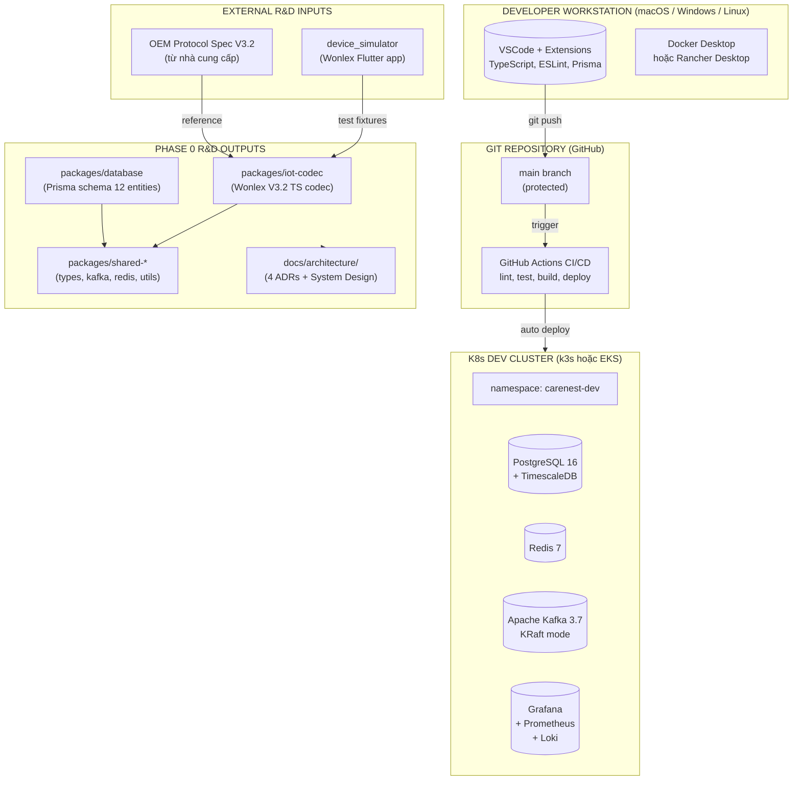

# Phase 0: Khởi động & R&D (Tuần 1-6)

## Context Links
- Project docs: [carenest-de-xuat.md](../../docs/carenest-de-xuat.md), [carenest-bmc-report.md](../../docs/carenest-bmc-report.md)
- Related reports: [device_simulator PDR](../../device_simulator/docs/project-overview-pdr.md)
- Wonlex protocol reference: [wonlex_protocol.dart](../../device_simulator/lib/services/wonlex_protocol.dart)
- Skill liên quan: `.claude/skills/wonlex-tcp-command/`
- Đề xuất Section 13.2: Lộ trình 30 tuần (Gantt chart p0_1, p0_2, p0_3)
- BMC Section 7.4: Tài nguyên pháp lý cần có
- BMC Section 8.1: Sprint Roadmap S0-S14
- BMC Section 12.1: Phase 0 Go-to-Market (Tháng 1-2)
- BMC Section 15: Tech Stack chi tiết

## Overview
- **Priority**: 🔴 Critical (chặn mọi phase sau)
- **Current Status**: Not Started
- **Owner**: CEO + CTO (co-founders)
- **Brief Description**:
  Phase 0 là nền móng quyết định toàn bộ dự án CareNest. Trong 6 tuần, đội ngũ thực hiện đồng thời ba luồng công việc: (1) thành lập pháp nhân, ký hợp đồng luật sư chuyên TMĐT-TTBYT-PDPA và nộp hồ sơ đăng ký sàn; (2) tuyển dụng team core 6-8 người, khởi tạo monorepo Turborepo, thiết lập CI/CD và K8s dev cluster; (3) R&D giao thức Wonlex V3.2 dựa trên reference từ `device_simulator`, thiết kế Prisma schema cho 12 entities ban đầu. Kết thúc Phase 0 phải có System Design Doc 50-80 trang, monorepo skeleton chạy được, codec library có unit tests >95% coverage, và team sẵn sàng kickoff Sprint S1.

## Key Insights
- **Zero-base = cơ hội kiến trúc sạch nhưng execution risk cao**: Xây từ số 0 cho phép thiết kế Clean Architecture, DDD và multi-tenant chuẩn ngay từ đầu, nhưng thời gian đến launch dài hơn ~6 tuần so với kế thạch có sẵn (xem BMC 16.3) và cần thêm 2-5 tỷ vốn.
- **Pháp lý TTBYT chạy song song và kéo dài**: Thủ tục đăng ký sàn TMĐT (BCT 2-4 tuần), merchant VNPay (2-4 tuần), DPIA (1 tháng) và đăng ký nhãn hiệu (12-18 tháng) đều phải khởi động tuần 1 vì là critical path cho MVP pilot.
- **Wonlex V3.2 protocol đã có reference**: `device_simulator/lib/services/wonlex_protocol.dart` đã implement format `[3G*{deviceId}*{LLLL}*{content}]` — Phase 0 R&D sẽ dùng làm test fixtures và viết lại bằng TypeScript với đầy đủ packet types (login, heartbeat, location, vitals, SOS, fall, low_battery) còn thiếu.
- **Team core phải hire xong trước khi viết code production**: Theo BMC 12.1, cần hire xong 6-8 người core (CTO + 3 Backend + 1 Frontend + 1 DevOps + 1 IoT Eng + 1 PM/Designer) trước tuần 4 để Sprint S1 (Auth + Multi-tenant) khởi động đúng tiến độ.
- **K8s dev cluster + observability phải sẵn sàng tuần 3**: Việc deploy PostgreSQL 16 + TimescaleDB + Redis 7 + Kafka 3.7 (KRaft) ngay từ đầu giúp tránh nợ kỹ thuật và cho phép team làm việc với môi trường giống production từ Sprint đầu tiên.

## Requirements

### Functional Requirements (FR)
- **FR-0.1**: Thành lập công ty TNHH 2 thành viên tại Sở KH&ĐT TP.HCM (3-5 ngày làm việc), có MST, con dấu, đăng ký ngành nghề chính "Bán lẻ thiết bị y tế qua TMĐT" (mã ngành 4791).
- **FR-0.2**: Ký hợp đồng retainer với công ty luật chuyên TMĐT + TTBYT + PDPA, mức 5-10 triệu/tháng, có tư vấn sơ bộ về 5 văn bản pháp lý chính (NĐ 52/2013, NĐ 98/2021, NĐ 13/2023, TT 09/2015, NĐ 181/2013).
- **FR-0.3**: Nộp hồ sơ đăng ký sàn TMĐT tại Cục TMĐT - Bộ Công Thương (timeline duyệt 2-4 tuần), đồng thời đăng ký merchant VNPay (timeline 2-4 tuần) và merchant MoMo backup.
- **FR-0.4**: Hire đủ 8 người core team theo BMC 7.3: CEO, CTO, 3 Backend Senior (22-32tr), 1 Frontend Senior (18-26tr), 1 DevOps (22-30tr), 1 IoT Engineer (20-30tr), 1 PM/Designer (15-22tr).
- **FR-0.5**: Khởi tạo monorepo `care-nest/` với Turborepo + pnpm workspaces, skeleton cho 5 nhóm: `apps/`, `services/`, `packages/`, `infrastructure/`, `tools/`.
- **FR-0.6**: Thiết kế Database ERD cho 12 entities: User, Seller, Product, Order, Device, Subscription, Payment, Shipment, Caregiver, Notification, AuditLog, SellerKycDocument.
- **FR-0.7**: Setup GitHub Actions CI pipeline (lint + type-check + unit test + build) và CD pipeline auto deploy lên K8s dev/staging cluster (k3s hoặc EKS), có branch protection rules và CODEOWNERS.
- **FR-0.8**: R&D Wonlex V3.2 protocol → viết TypeScript codec library tại `packages/iot-codec/` với đầy đủ packet types: login, heartbeat, location (GPS/LBS/WiFi), vitals (HR, SpO2, BP, temp), SOS, fall_detected, low_battery, geo_fence_breach.
- **FR-0.9**: Tạo mock TCP server tại `packages/iot-codec/test/mock-server.ts` có thể nhận và giải mã packets tương thích ngược với `device_simulator`, dùng cho dev/test nội bộ.
- **FR-0.10**: Nộp hồ sơ DPIA (Data Protection Impact Assessment) cho Bộ Công An theo NĐ 13/2023, có luật sư chuyên PDPA review (budget 15-30 triệu).
- **FR-0.11**: Nộp đơn đăng ký nhãn hiệu "CareNest" tại Cục Sở hữu trí tuệ (timeline 12-18 tháng nhưng nộp sớm để bảo vệ thương hiệu).
- **FR-0.12**: Viết System Design Doc tổng thể 50-80 trang, gồm 4 ADR (Architecture Decision Records) ban đầu: ADR-001 Turborepo, ADR-002 NestJS+Prisma+TimescaleDB, ADR-003 IoT ingestion, ADR-004 Multi-tenant strategy.

### Non-Functional Requirements (NFR)
- **NFR-0.1**: Database design phải hỗ trợ multi-tenant từ session đầu tiên — mọi bảng nghiệp vụ phải có cột `tenant_id` (sau này là `seller_id` cho seller-scoped data) và Prisma middleware tự động inject điều kiện `WHERE tenant_id = :current` vào mọi query.
- **NFR-0.2**: Tất cả primary key phải dùng UUID v7 (time-ordered, 128-bit) thay vì auto-increment integer — phù hợp với distributed systems, dễ merge data, không leak business info.
- **NFR-0.3**: Audit log phải capture mọi thao tác admin (CRUD trên Seller, Product, Order status, Refund) với 7 trường bắt buộc: actor_id, actor_role, action, resource_type, resource_id, before_state, after_state, ip_address, user_agent; lưu 7 năm theo yêu cầu PDPA.
- **NFR-0.4**: Tuân thủ PDPA từ thiết kế: có cơ chế Explicit Consent riêng cho dữ liệu sức khỏe (vitals, location), quyền truy cập/sửa/xóa dữ liệu của user phải có API endpoint (sẽ implement Phase 1 nhưng schema phải sẵn sàng).
- **NFR-0.5**: Code quality: TypeScript strict mode (`"strict": true`), ESLint + Prettier với config chuẩn Airbnb, Husky pre-commit hooks chạy lint-staged, commitlint enforce Conventional Commits.
- **NFR-0.6**: Mã hóa AES-256 cho dữ liệu at rest (PostgreSQL TDE, S3 SSE-KMS), TLS 1.3 cho data in transit, secrets quản lý qua HashiCorp Vault hoặc AWS Secrets Manager — không hardcode trong code.

## Architecture

### Monorepo Structure (đề xuất)

```
care-nest/                          # Root monorepo
├── apps/
│   ├── web-buyer/                   # Next.js 14 (Phase 2)
│   ├── web-seller/                  # Next.js 14 (Phase 2)
│   ├── web-admin/                   # Next.js 14 (Phase 2)
│   └── iot-gateway/                 # Node.js TCP server (Phase 1)
├── services/
│   ├── auth-service/                # NestJS (Phase 1)
│   ├── catalog-service/             # NestJS (Phase 1)
│   ├── order-service/               # NestJS (Phase 1)
│   ├── payment-service/             # NestJS (Phase 2)
│   ├── device-service/              # NestJS (Phase 1)
│   └── notification-service/        # NestJS (Phase 2)
├── packages/
│   ├── shared-types/                # TypeScript types, Zod schemas
│   ├── shared-config/               # Env, constants
│   ├── shared-kafka/                # Kafka producers/consumers wrapper
│   ├── shared-redis/                # Redis client + helpers
│   ├── shared-utils/                # Logger, validators, error codes
│   ├── database/                    # Prisma schema + migrations
│   └── iot-codec/                   # Wonlex V3.2 protocol (Phase 0!)
├── infrastructure/
│   ├── k8s/                         # Kubernetes manifests
│   ├── terraform/                   # IaC
│   └── docker/                      # Dockerfiles
├── tools/
│   ├── scripts/                     # Build/deploy scripts
│   └── docs/                        # ADRs, runbooks
├── .github/
│   └── workflows/                   # GitHub Actions
├── turbo.json
├── pnpm-workspace.yaml
└── package.json
```

### System Architecture Diagram (Phase 0 focus)



### Data Model (ERD Phase 0 - high level)

```
┌──────────────────────┐       ┌──────────────────────┐
│       USER           │       │      SELLER          │
├──────────────────────┤       ├──────────────────────┤
│ id (UUID v7)         │       │ id (UUID v7)         │
│ email                │       │ owner_user_id (FK)   │
│ phone                │       │ legal_name           │
│ password_hash        │       │ tax_code             │
│ full_name            │       │ business_address     │
│ role (enum)          │       │ medical_license_no   │
│ created_at           │       │ kyc_status (enum)    │
│ updated_at           │       │ created_at           │
│ deleted_at           │       │ updated_at           │
└──────────┬───────────┘       └──────────┬───────────┘
           │                              │
           │ 1:1                          │ 1:N
           ▼                              ▼
┌──────────────────────┐       ┌──────────────────────┐
│      CAREGIVER       │       │   SellerKycDocument  │
├──────────────────────┤       ├──────────────────────┤
│ id (UUID v7)         │       │ id (UUID v7)         │
│ user_id (FK)         │       │ seller_id (FK)       │
│ device_id (FK)       │       │ doc_type (enum)      │
│ role (enum)          │       │ file_url (S3)        │
│ invited_by (FK)      │       │ verified_at          │
│ accepted_at          │       │ verified_by (FK)     │
└──────────┬───────────┘       └──────────────────────┘
           │
           │ N:1
           ▼
┌──────────────────────┐       ┌──────────────────────┐
│       DEVICE         │       │       PRODUCT        │
├──────────────────────┤       ├──────────────────────┤
│ id (UUID v7)         │       │ id (UUID v7)         │
│ device_serial (IMEI) │       │ seller_id (FK)       │
│ model (enum)         │       │ sku                  │
│ firmware_version     │       │ name                 │
│ seller_id (FK)       │       │ medical_class (A-D)  │
│ order_id (FK, NULL)  │       │ circulation_no       │
│ subscription_id (FK) │       │ description          │
│ status (enum)        │       │ base_price           │
│ last_seen_at         │       │ stock                │
│ created_at           │       │ review_status (enum) │
└──────────┬───────────┘       │ category_id (FK)     │
           │                   │ created_at           │
           │ 1:N               └──────────┬───────────┘
           ▼                              │
┌──────────────────────┐                  │ N:1
│  DEVICE_TELEMETRY    │       ┌──────────▼───────────┐
│  (TimescaleDB        │       │       ORDER          │
│   hypertable)        │       ├──────────────────────┤
├──────────────────────┤       │ id (UUID v7)         │
│ time (PARTITION KEY) │       │ buyer_user_id (FK)   │
│ device_id (FK)       │       │ parent_order_id (FK) │
│ metric_type (enum)   │       │ seller_id (FK)       │
│ metric_value (JSONB) │       │ status (enum)        │
│ battery_pct          │       │ subtotal             │
│ location (GEOGRAPHY) │       │ shipping_fee         │
└──────────────────────┘       │ total                │
                               │ created_at           │
┌──────────────────────┐       └──────────┬───────────┘
│    SUBSCRIPTION      │                  │
├──────────────────────┤                  │ 1:N
│ id (UUID v7)         │                  ▼
│ device_id (FK)       │       ┌──────────────────────┐
│ plan_code (FK)       │       │       PAYMENT        │
│ status (enum)        │       ├──────────────────────┤
│ started_at           │       │ id (UUID v7)         │
│ expires_at           │       │ order_id (FK)        │
│ auto_renew           │       │ gateway (enum)       │
│ gateway_sub_id       │       │ gateway_txn_id       │
└──────────────────────┘       │ amount               │
                               │ status (enum)        │
┌──────────────────────┐       │ idempotency_key      │
│     SHIPMENT         │       │ paid_at              │
├──────────────────────┤       └──────────────────────┘
│ id (UUID v7)         │
│ order_id (FK)        │       ┌──────────────────────┐
│ carrier (enum)       │       │     NOTIFICATION     │
│ tracking_no          │       ├──────────────────────┤
│ status (enum)        │       │ id (UUID v7)         │
│ cod_amount           │       │ user_id (FK)         │
│ estimated_delivery   │       │ channel (enum)       │
│ actual_delivery      │       │ type (enum)          │
└──────────────────────┘       │ payload (JSONB)      │
                               │ read_at              │
┌──────────────────────┐       └──────────────────────┘
│     AUDIT_LOG        │
├──────────────────────┤       (12 entities tổng cộng)
│ id (UUID v7)         │
│ actor_id (FK)        │
│ actor_role (enum)    │
│ action (enum)        │
│ resource_type        │
│ resource_id          │
│ before_state (JSONB) │
│ after_state (JSONB)  │
│ ip_address           │
│ user_agent           │
│ created_at           │
└──────────────────────┘
```

### Key Design Decisions

- **Chọn Turborepo thay vì NX**: Turborepo có build cache thông minh (Remote Caching với Vercel), config đơn giản hơn NX, phù hợp team 6-8 người, hệ sinh thái pnpm workspace trưởng thành. NX mạnh hơn cho monorepo lớn 50+ packages nhưng overhead không cần thiết cho MVP.
- **Chọn Prisma thay vì TypeORM/MikroORM**: Prisma có schema declarative dễ review, auto-generated types giảm boilerplate, migration history tốt, introspection DB tốt. TypeORM có decorator pattern dễ conflict với NestJS DI. Plan dùng Prisma kết hợp raw SQL cho TimescaleDB hypertables.
- **Chọn pnpm thay vì npm/yarn**: pnpm tiết kiệm disk (content-addressable store), nhanh hơn 2-3x, hỗ trợ workspace tốt, có filter commands tiện cho monorepo. Nhược điểm: dependency resolution strict hơn, đôi khi cần `.npmrc` config.
- **Wonlex protocol R&D tham khảo device_simulator nhưng viết lại bằng TS**: Simulator dùng Dart với regex parsing đơn giản, production cần TypeScript với Zod schema validation đầy đủ, error handling tốt hơn, type-safe, test coverage >95%. Test fixtures lấy từ simulator output.
- **Chọn Kafka KRaft mode (không ZooKeeper)**: Giảm complexity vận hành (1 service thay vì 2), metadata tự quản lý, scale tốt hơn cho 8 topics ban đầu. Cần Kafka 3.3+, ops cần monitor controller quorum.
- **Chọn k3s cho dev cluster, EKS cho staging/prod**: k3s nhẹ (binary <100MB), chạy được trên máy dev có 16GB RAM, giảm chi phí dev. EKS managed control plane giảm ops burden cho production.
- **Chọn Zod cho validation thay vì class-validator**: Zod parse + type inference trong 1 bước, bundle size nhỏ hơn, syntax functional, dễ test. class-validator cần decorator metadata, nặng hơn.

## Related Code Files

### Files cần tạo trong Phase 0

- `care-nest/package.json` — root workspace config với scripts: `dev`, `build`, `lint`, `test`, `db:migrate`, `db:seed`
- `care-nest/pnpm-workspace.yaml` — workspace globs: `apps/*`, `services/*`, `packages/*`
- `care-nest/turbo.json` — Turborepo pipeline: build, lint, test, type-check với dependency graph
- `care-nest/.npmrc` — pnpm config: `auto-install-peers=true`, `shamefully-hoist=false`
- `care-nest/.nvmrc` — Node 20 LTS
- `care-nest/.editorconfig` — consistent formatting
- `care-nest/.gitignore` — ignore node_modules, dist, .env, .turbo
- `care-nest/.github/workflows/ci.yml` — CI: lint, type-check, unit test, build matrix Node 20
- `care-nest/.github/workflows/cd-staging.yml` — CD: auto deploy staging khi merge vào main
- `care-nest/.github/CODEOWNERS` — yêu cầu review: CTO approve mọi thay đổi
- `care-nest/packages/shared-types/src/index.ts` — entry point export tất cả types
- `care-nest/packages/shared-types/src/user.ts` — User, Role, UserStatus enums
- `care-nest/packages/shared-types/src/seller.ts` — Seller, KycStatus, MedicalClass enums
- `care-nest/packages/shared-types/src/order.ts` — Order, OrderStatus, PaymentStatus
- `care-nest/packages/shared-types/src/device.ts` — Device, DeviceStatus, TelemetryMetric
- `care-nest/packages/shared-config/src/env.ts` — Zod-validated env loader
- `care-nest/packages/shared-config/src/constants.ts` — error codes, business rules
- `care-nest/packages/shared-kafka/src/producer.ts` — KafkaJS producer wrapper
- `care-nest/packages/shared-kafka/src/consumer.ts` — consumer với retry + DLQ
- `care-nest/packages/shared-kafka/src/topics.ts` — 8 topic constants
- `care-nest/packages/shared-redis/src/client.ts` — ioredis wrapper
- `care-nest/packages/shared-redis/src/cache.ts` — get/set helpers với TTL
- `care-nest/packages/shared-utils/src/logger.ts` — Pino logger structured JSON
- `care-nest/packages/shared-utils/src/errors.ts` — custom error classes
- `care-nest/packages/shared-utils/src/uuid.ts` — UUID v7 generator
- `care-nest/packages/iot-codec/src/wonlex.ts` — main parser, format `[3G*{deviceId}*{LLLL}*{content}]`
- `care-nest/packages/iot-codec/src/packets/login.ts` — Login packet (deviceId + IMEI)
- `care-nest/packages/iot-codec/src/packets/heartbeat.ts` — Heartbeat packet
- `care-nest/packages/iot-codec/src/packets/location.ts` — GPS/LBS/WiFi location
- `care-nest/packages/iot-codec/src/packets/vitals.ts` — Heart rate, SpO2, BP, temp
- `care-nest/packages/iot-codec/src/packets/sos.ts` — SOS alert
- `care-nest/packages/iot-codec/src/packets/fall-detected.ts` — Fall detection alert
- `care-nest/packages/iot-codec/src/packets/low-battery.ts` — Low battery warning
- `care-nest/packages/iot-codec/test/wonlex.spec.ts` — Codec unit tests (target 95% coverage)
- `care-nest/packages/iot-codec/test/mock-server.ts` — Mock TCP server cho dev test
- `care-nest/packages/iot-codec/test/fixtures/` — sample packets từ `device_simulator`
- `care-nest/packages/database/prisma/schema.prisma` — Prisma schema đầu tiên (12 entities)
- `care-nest/packages/database/prisma/migrations/0001_init/migration.sql` — initial migration
- `care-nest/packages/database/prisma/seed.ts` — seed admin user, sample categories
- `care-nest/packages/database/src/client.ts` — Prisma client với multi-tenant middleware
- `care-nest/infrastructure/k8s/dev/namespace.yaml` — namespace `carenest-dev`
- `care-nest/infrastructure/k8s/dev/postgres-statefulset.yaml` — PG + TimescaleDB
- `care-nest/infrastructure/k8s/dev/kafka-statefulset.yaml` — Kafka 3.7 KRaft
- `care-nest/infrastructure/k8s/dev/redis-deployment.yaml`
- `care-nest/infrastructure/k8s/dev/grafana-deployment.yaml` — observability
- `care-nest/infrastructure/k8s/dev/ingress.yaml` — Traefik ingress
- `care-nest/infrastructure/docker/postgres.Dockerfile` — PG16 + TimescaleDB image
- `care-nest/infrastructure/docker/node-base.Dockerfile` — base image cho services
- `care-nest/docs/architecture/00-overview.md` — System Design overview
- `care-nest/docs/architecture/01-monorepo.md` — ADR-001: Turborepo rationale
- `care-nest/docs/architecture/02-database-design.md` — ADR-002 + ERD
- `care-nest/docs/architecture/03-iot-protocol.md` — ADR-003 + Wonlex spec
- `care-nest/docs/architecture/04-multi-tenant.md` — ADR-004 multi-tenant strategy
- `care-nest/docs/legal/dpia-report.md` — Data Protection Impact Assessment
- `care-nest/docs/legal/san-tmdt-checklist.md` — checklist đăng ký sàn
- `care-nest/docs/legal/seller-onboarding-template.md` — KYC template

### Files KHÔNG tạo (sẽ tạo ở phase sau)
- KHÔNG tạo: `services/*/src/main.ts` cho bất kỳ NestJS service nào — Phase 1
- KHÔNG tạo: `apps/web-buyer/app/*` Next.js routes — Phase 2 (Sprint S9-S11)
- KHÔNG tạo: VNPay/MoMo/ZaloPay integration code — Phase 2
- KHÔNG tạo: GHN/GHTK API client — Phase 2
- KHÔNG tạo: production deployment Terraform — Phase 3

## Implementation Steps

### Tuần 1: Pháp lý & Setup Công ty
1. (CEO) Gặp 3 công ty luật chuyên TMĐT, đánh giá, ký retainer 5-10tr/tháng với công ty có kinh nghiệm NĐ 13/2023 + NĐ 98/2021.
2. (CEO) Đăng ký công ty TNHH 2 thành viên tại Sở KH&ĐT TP.HCM, vốn điều lệ 2 tỷ, ngành chính 4791 (Bán lẻ thiết bị y tế qua TMĐT) — 3-5 ngày.
3. (CEO) Mở tài khoản doanh nghiệp tại Techcombank hoặc VPBank (1-2 ngày), đăng ký internet banking + token.
4. (CEO) Nộp hồ sơ đăng ký sàn TMĐT tại Cục TMĐT - Bộ Công Thương, kèm Quy chế sàn draft (luật sư review).
5. (CEO + Legal) Chuẩn bị 8 bộ JD: CTO, 3 Backend Senior, 1 Frontend Senior, 1 DevOps, 1 IoT Engineer, 1 PM, 1 Designer; đăng lên TopCV, ITviec, LinkedIn.
6. (CTO) Liên hệ 5 nhà cung cấp thiết bị Wonlex/OEM (Wonlex, Chuangcool, Juesheng, OEMs Trung Quốc), xin tài liệu protocol V3.2 + sample packets + giá sỉ.
7. (CTO) Liên hệ 5 nhà phân phối TTBYT lớn tại HCM + HN (Thiết bị y tế Hải Nam, Vinamed, Bemes, Metech, Vạn Phúc) cho pilot sellers.
8. (CTO) Đăng ký merchant VNPay tại https://merchant.vnpay.vn/, chuẩn bị docs: GPKD, MST, giấy phép TTBYT, sample website (placeholder), bản kê khai doanh thu dự kiến — timeline duyệt 2-4 tuần.

### Tuần 2: Tuyển dụng & Tech planning
9. (CEO) Phỏng vấn CTO/Tech Lead ưu tiên tuyển xong trước mọi thứ khác — target offer trong tuần 2, on-board đầu tuần 3.
10. (CTO) Phỏng vấn 3 Backend Senior (yêu cầu: NestJS + PostgreSQL + Kafka + IoT protocols experience, 5+ năm), offer range 22-32tr.
11. (CTO) Phỏng vấn 1 Frontend Senior (Next.js 14 App Router + TypeScript + TailwindCSS, 4+ năm), offer 18-26tr.
12. (CTO) Phỏng vấn 1 DevOps (K8s + AWS/GCP + Terraform + GitHub Actions, 4+ năm), offer 22-30tr.
13. (CTO) Phỏng vấn 1 IoT Engineer (Protocol parsing TCP/UDP/MQTT, embedded C/C++ background, 3+ năm), offer 20-30tr.
14. (CTO) Thiết kế ERD sơ bộ cho 6 core entities: User, Seller, Product, Order, Device, Subscription (sẽ refine thêm 6 entities ở tuần 5).
15. (CTO) Setup GitHub organization `carenest-vn`, branch protection rules trên `main`, CODEOWNERS file, bật Dependabot + Secret Scanning.
16. (CTO) Setup Slack workspace `carenest.slack.com`, channels: #general, #tech, #legal, #hiring, #phase-0-launch.

### Tuần 3: Monorepo + CI/CD
17. (CTO + DevOps) Khởi tạo monorepo `care-nest/` tại https://github.com/carenest-vn/care-nest với Turborepo + pnpm workspaces, init git, first commit.
18. (DevOps) Setup Dockerfile chuẩn cho Node.js services (multi-stage build, Alpine base, non-root user, healthcheck).
19. (DevOps) Setup GitHub Actions CI: lint (ESLint), type-check (tsc --noEmit), unit test (Vitest), build (Turborepo), chạy trên PR + main.
20. (DevOps) Setup K8s dev cluster (k3s trên EC2 t4g.medium hoặc EKS fargate profile) với namespace `carenest-dev`.
21. (DevOps) Deploy PostgreSQL 16 + TimescaleDB 2.x lên K8s dev (StatefulSet, 10GB PVC, daily backup script).
22. (DevOps) Deploy Redis 7 lên K8s dev (Deployment, AOF persistence enabled).
23. (DevOps) Deploy Kafka 3.7 KRaft mode lên K8s dev (3 brokers StatefulSet, internal listener, auto-create topics).
24. (DevOps) Setup Grafana + Prometheus + Loki stack trên K8s dev, có 4 dashboard ban đầu: Infra, Kafka, Postgres, App.
25. (CTO) Viết ADR-001 tại `docs/architecture/01-monorepo.md`: Tại sao chọn Turborepo + pnpm + NestJS (2-3 trang).
26. (CTO) Viết ADR-002 tại `docs/architecture/02-database-design.md`: Tại sao chọn Prisma + TimescaleDB + Redis 7 (3-4 trang kèm ERD).

### Tuần 4: R&D Wonlex Protocol
27. (IoT Engineer + CTO) R&D Wonlex V3.2 protocol spec: format `[3G*{deviceId}*{LLLL}*{content}]`, LLLL là 4-digit hex uppercase của UTF-8 byte length.
28. (IoT Engineer) Tham khảo `device_simulator/lib/services/wonlex_protocol.dart` để hiểu implementation Dart, capture test fixtures từ simulator.
29. (IoT Engineer) Viết `packages/iot-codec/src/wonlex.ts` — main parser/builder với Zod validation, error handling.
30. (IoT Engineer) Implement 8 packet types: login, heartbeat, location (GPS/LBS/WiFi), vitals (HR, SpO2, BP, temp), SOS, fall_detected, low_battery, geo_fence_breach.
31. (IoT Engineer) Viết unit tests cho codec (target coverage >95%), test cases: valid packets, malformed packets, edge cases (empty content, max length 9999 bytes).
32. (IoT Engineer) Tạo mock TCP server tại `packages/iot-codec/test/mock-server.ts` chạy trên port 7777, accept connection từ `device_simulator`.
33. (CTO) Viết ADR-003 tại `docs/architecture/03-iot-protocol.md`: Kiến trúc IoT ingestion (TCP Gateway → Decode → Kafka → Workers).
34. (Backend Senior) Setup `packages/shared-kafka` với KafkaJS producer/consumer wrapper, retry logic, DLQ pattern.
35. (Backend Senior) Setup `packages/shared-redis` với ioredis client, cache helpers (get/set/del với TTL), session store.
36. (Backend Senior) Setup `packages/database` với Prisma schema đầu tiên (12 entities: User, Seller, Product, Order, Device, Subscription, Payment, Shipment, Caregiver, Notification, AuditLog, SellerKycDocument).

### Tuần 5: DB Design + Legal deep dive
37. (CTO + Backend Senior) Refine ERD, thêm 6 entities: Payment, Shipment, Caregiver, Notification, AuditLog, SellerKycDocument.
38. (Backend Senior) Implement multi-tenant row-level security trong Prisma schema: mỗi business entity có `seller_id` (nullable cho admin), middleware auto-inject `WHERE seller_id = :current` dựa trên JWT context.
39. (Backend Senior) Setup Prisma migration `0001_init` với toàn bộ 12 entities, indexes (UUID, FK, composite), constraints (UNIQUE email, CHECK stock >= 0).
40. (Backend Senior) Viết seed scripts cho dev environment: 1 admin user, 5 sample categories, 10 sample products, 2 test sellers, 5 test devices.
41. (CEO + Legal consultant) Họp với Sở Y tế TP.HCM về điều kiện kinh doanh TTBYT (xác nhận sàn chỉ là marketplace, không trực tiếp bán → không cần giấy phép TTBYT riêng).
42. (CEO) Nộp hồ sơ DPIA cho Bộ Công An (qua Cổng dịch vụ công), kèm báo cáo đánh giá tác động do luật sư chuyên PDPA soạn.
43. (CEO + Legal) Hoàn thiện Quy chế hoạt động sàn CareNest (15-20 trang), nộp kèm hồ sơ đăng ký sàn TMĐT.
44. (CTO) Đăng ký nhãn hiệu "CareNest" + logo tại Cục SHTT Việt Nam, nộp qua Cổng dịch vụ công IPVN.
45. (CTO + Designer) Wireframe v0.1 cho web-buyer homepage (Figma): hero section, categories, featured products, IoT health banner.

### Tuần 6: Finalize Phase 0
46. (CTO) Review toàn bộ monorepo + DB schema + IoT codec, kiểm tra lint + test + build đều pass.
47. (CTO) Viết System Design Doc tổng thể (50-80 trang) tại `docs/architecture/00-overview.md`, gồm 4 ADR + ERD + sequence diagrams.
48. (CTO) Demo cho nhà đầu tư / stakeholder: kiến trúc tổng thể + tiến độ + roadmap, target raise Pre-seed 2-3 tỷ.
49. (CTO) Sprint retrospective Phase 0: rút kinh nghiệm, document lessons learned, update risk register.
50. (CEO) Hire hoàn tất team core 8 người, ký hợp đồng lao động, BHXH, setup payroll.
51. (CTO) Kickoff Phase 1, Sprint S1: Auth + Multi-tenant, mời team vào Slack channel #phase-1-core-platform.

## Todo List
- [ ] Tuần 1: Hoàn tất đăng ký công ty TNHH + MST + tài khoản ngân hàng
- [ ] Tuần 1: Ký retainer với luật sư chuyên TMĐT-TTBYT-PDPA
- [ ] Tuần 1: Đăng ký merchant VNPay (background process 2-4 tuần)
- [ ] Tuần 1: Đăng 8 JD tuyển dụng trên TopCV, ITviec, LinkedIn
- [ ] Tuần 2: Phỏng vấn và offer CTO/Tech Lead
- [ ] Tuần 2: Phỏng vấn 3 Backend Senior (NestJS + Kafka + IoT)
- [ ] Tuần 2: Phỏng vấn 1 Frontend Senior + 1 DevOps + 1 IoT Engineer
- [ ] Tuần 2: Phỏng vấn 1 PM + 1 Designer
- [ ] Tuần 3: Setup monorepo `care-nest/` với Turborepo + pnpm
- [ ] Tuần 3: Setup CI/CD GitHub Actions (lint + test + build)
- [ ] Tuần 3: Deploy K8s dev cluster (k3s hoặc EKS)
- [ ] Tuần 3: Deploy PostgreSQL 16 + TimescaleDB + Redis 7 + Kafka 3.7 lên K8s
- [ ] Tuần 3: Setup monitoring stack (Grafana + Prometheus + Loki)
- [ ] Tuần 3: Viết ADR-001 (Turborepo) + ADR-002 (Database)
- [ ] Tuần 4: Hoàn thành R&D Wonlex V3.2 protocol spec
- [ ] Tuần 4: Viết `packages/iot-codec/` với 8 packet types
- [ ] Tuần 4: Codec unit tests pass với coverage >95%
- [ ] Tuần 4: Tạo mock TCP server tương thích `device_simulator`
- [ ] Tuần 4: Setup shared-kafka, shared-redis, shared-types packages
- [ ] Tuần 5: Finalize Prisma schema với 12 entities + multi-tenant
- [ ] Tuần 5: Prisma migration 0001 + seed scripts
- [ ] Tuần 5: Nộp hồ sơ DPIA cho Bộ Công An
- [ ] Tuần 5: Hoàn thiện Quy chế sàn + nộp đăng ký sàn TMĐT
- [ ] Tuần 5: Đăng ký nhãn hiệu "CareNest" tại Cục SHTT
- [ ] Tuần 5: Wireframe v0.1 web-buyer homepage (Figma)
- [ ] Tuần 6: Code review toàn bộ monorepo + DB schema + codec
- [ ] Tuần 6: Viết System Design Doc 50-80 trang + 4 ADRs
- [ ] Tuần 6: Demo cho nhà đầu tư (Pre-seed raise 2-3 tỷ)
- [ ] Tuần 6: Hire xong 8 người core, ký hợp đồng
- [ ] Tuần 6: Sprint retrospective + kickoff Phase 1 Sprint S1

## Success Criteria
- ✅ Công ty TNHH đã đăng ký hợp lệ với MST, vốn điều lệ 2 tỷ, ngành nghề 4791, có tài khoản ngân hàng doanh nghiệp.
- ✅ Hợp đồng luật sư retainer đã ký (5-10tr/tháng), có tư vấn sơ bộ bằng văn bản về NĐ 13/2023 + NĐ 98/2021 + NĐ 52/2013.
- ✅ 8/8 người core team đã hire ký hợp đồng: CEO, CTO, 3 Backend Senior, 1 Frontend Senior, 1 DevOps, 1 IoT Engineer, 1 PM/Designer.
- ✅ Monorepo `care-nest/` đã setup tại GitHub, có CI pass (lint + test + build xanh), branch protection rules active, CODEOWNERS enforced.
- ✅ K8s dev cluster chạy ổn định 7 ngày liên tục không crash, có thể `kubectl apply` từ máy dev.
- ✅ PostgreSQL 16 + TimescaleDB + Redis 7 + Kafka 3.7 (KRaft) đã deploy lên K8s dev, connection string test pass từ máy dev qua port-forward.
- ✅ Wonlex V3.2 codec library `packages/iot-codec/` có unit tests pass với coverage >95%, build thành công, mock TCP server chạy được.
- ✅ Mock TCP server nhận và giải mã thành công packets từ `device_simulator` (round-trip test pass).
- ✅ Prisma schema cho 12 entities đã có migration `0001_init`, có seed scripts chạy được trên dev DB.
- ✅ DPIA report đã nộp cho Bộ Công An, có biên nhận.
- ✅ Hồ sơ đăng ký sàn TMĐT đã nộp Bộ Công Thương (chờ duyệt 2-4 tuần).
- ✅ Hồ sơ đăng ký merchant VNPay đã nộp (chờ duyệt 2-4 tuần).
- ✅ Đơn đăng ký nhãn hiệu "CareNest" đã nộp Cục SHTT (chờ duyệt 12-18 tháng).
- ✅ System Design Doc 50-80 trang đã viết và review bởi 2+ stakeholders.
- ✅ Wireframe v0.1 Figma cho web-buyer homepage đã có, được PM + Designer + CTO review.
- ✅ Pre-seed funding target 2-3 tỷ đã có commitment từ founders + FFF (Friends, Family, Founders).

## Risk Assessment

| # | Rủi ro | XS | TD | Mức | Phòng ngừa | Owner |
|---|--------|-----|-----|------|------------|-------|
| 1 | Không tuyển được kỹ sư IoT có kinh nghiệm protocol parsing | TB | Cao | 🔴 | Tuyển từ tuần 1, offer equity 0.1-0.5%, remote-friendly, backup plan outsource codec cho freelancer VN/Ukraine | CTO |
| 2 | Thủ tục đăng ký sàn TMĐT kéo dài >4 tuần | Cao | Cao | 🔴 | Nộp hồ sơ tuần 1, có luật sư đối chiếu, MVP có thể chạy ở subdomain test, pilot với 3-5 sellers đầu | CEO + Legal |
| 3 | Đăng ký merchant VNPay bị từ chối hoặc kéo dài | TB | Cao | 🔴 | Chuẩn bị docs pháp lý đầy đủ, backup MoMo parallel đăng ký tuần 2, có COD fallback cho MVP | CEO + CTO |
| 4 | Nhà cung cấp thiết bị Wonlex không chia sẻ protocol spec | TB | Cao | 🟠 | Test với simulator là đủ cho MVP, song song liên hệ 2-3 OEM khác, R&D reverse-engineer từ packet captures | IoT Eng |
| 5 | Hire chậm, thiếu người cho Sprint S1 đầu Phase 1 | TB | Cao | 🟠 | Có 2-3 freelancer backup, founder code tạm thời các phần đơn giản, mở rộng JD sang junior/senior | CEO |
| 6 | K8s dev cluster setup phức tạp, dev chậm triển khai | TB | TB | 🟡 | Dùng k3s local cho dev (đơn giản), EKS cho staging, có DevOps Senior setup từ tuần 3 | DevOps |
| 7 | DPIA report bị Bộ Công An yêu cầu bổ sung nhiều lần | TB | TB | 🟡 | Có luật sư chuyên PDPA review, budget thêm 1-2 tháng, chuẩn bị template câu trả lời | Legal |
| 8 | CTO candidate nhận offer nhưng không on-board đúng hẹn | TB | Cao | 🟠 | Có 2-3 finalist cho CTO, ký offer letter có commitment bonus, backup CTO part-time từ network | CEO |
| 9 | TimescaleDB + Kafka trên K8s dev gặp vấn đề resource (RAM/Disk) | TB | TB | 🟡 | Dùng k3s với 16GB RAM node, monitor sớm, fallback dùng Docker Compose local cho dev nhanh | DevOps |
| 10 | Codec library không cover hết packet types của device thật | Cao | TB | 🟠 | Test với 3+ loại device trước launch, có packet capture tool, tham khảo open-source Wonlex libraries (GitHub) | IoT Eng |

## Security Considerations

### Pháp lý & Tuân thủ
- **Nghị định 13/2023/NĐ-CP (PDPA)**:
  - DPIA bắt buộc cho dữ liệu sức khỏe (sensitive data) — nộp Bộ Công An trước khi vận hành.
  - Cần có cơ chế Explicit Consent riêng cho mỗi loại dữ liệu sức khỏe (heart rate, SpO2, GPS, v.v.).
  - Quyền truy cập/sửa/xóa dữ liệu của user phải được thiết kế API từ đầu (sẽ implement Phase 1).
  - Phải có Privacy Policy + Cookie Policy công khai trên web trước khi launch.
- **Nghị định 98/2021/NĐ-CP (TTBYT)**:
  - Sàn chỉ là marketplace (không trực tiếp bán) → cần xác nhận với Sở Y tế để tránh phải xin giấy phép TTBYT riêng (tiết kiệm 15-40 triệu + 1-3 tháng).
  - 100% sellers trên sàn phải có giấy phép TTBYT do Sở Y tế cấp (kiểm tra khi KYC).
  - 100% sản phẩm phải có số lưu hành/công bố Bộ Y tế (kiểm tra khi duyệt SKU).
- **Nghị định 52/2013 + 85/2021 (TMĐT)**:
  - Phải đăng ký sàn với BCT trước khi vận hành — timeline 2-4 tuần.
  - Phải công bố Quy chế sàn công khai trên website.
  - Phải có cơ chế tiếp nhận và giải quyết khiếu nại (timeline 24-48h).
- **Thông tư 09/2015/TT-NHNN**:
  - KHÔNG tự thu tiền thanh toán → bắt buộc qua cổng VNPay/MoMo/ZaloPay có phép.
  - Phải lưu trữ lịch sử giao dịch tối thiểu 5 năm.
- **Nghị định 181/2013/NĐ-CP (Quảng cáo y tế)**:
  - Mô tả sản phẩm không được dùng từ "chữa khỏi", "100% hiệu quả", "không tác dụng phụ".
  - Mọi tính năng phải khớp với hồ sơ công bố lưu hành.

### Bảo mật dữ liệu từ đầu
- **Mã hóa AES-256** cho data at rest (PostgreSQL TDE, S3 SSE-KMS, backup encryption).
- **TLS 1.3** cho data in transit (Cloudflare SSL, internal mTLS với Istio Phase 2).
- **Secrets management**: AWS Secrets Manager hoặc HashiCorp Vault, không hardcode trong code, rotate mỗi 90 ngày.
- **Database location**: 100% data center tại Việt Nam theo NĐ 13/2023 (chọn AWS region ap-southeast-1 Singapore hoặc VNG Cloud region VN).
- **Audit log**: ghi lại mọi thao tác admin, lưu 7 năm ở cold storage (S3 Glacier), không thể sửa/xóa.
- **RBAC** (Role-Based Access Control) từ session đầu tiên: 4 roles chính BUYER, SELLER, CAREGIVER, ADMIN với permission matrix rõ ràng.
- **Principle of least privilege** cho mọi service account: K8s service account chỉ có quyền tối thiểu cần thiết, dùng IRSA (IAM Roles for Service Accounts) trên EKS.
- **WAF** (Web Application Firewall) qua Cloudflare Pro chặn SQL injection, XSS, DDoS ngay từ đầu.
- **Rate limiting** ở API Gateway: 100 req/min cho anonymous, 1000 req/min cho authenticated, 10 req/sec cho payment endpoints.

## Next Steps

### Dependencies cho Phase 1
Phase 1 (Xây dựng Lõi Hệ thống, Tuần 7-18) phụ thuộc các deliverables Phase 0:
- [ ] Monorepo đã setup → bắt đầu code `services/auth-service` (NestJS) ở Sprint S1
- [ ] Prisma schema đã có → backend services dùng chung `packages/database`
- [ ] K8s dev cluster → deploy + test services ngay từ Sprint S1
- [ ] IoT codec library `packages/iot-codec` → dùng cho TCP Gateway ở Sprint S7
- [ ] Team 8 người đã hire → chia sprint: 1 CTO lead + 3 Backend (3 services) + 1 Frontend (web-seller) + 1 DevOps (CI/CD) + 1 IoT (Gateway) + 1 PM/Designer (UI/UX)
- [ ] System Design Doc → làm input cho Sprint Planning
- [ ] ADRs → guideline cho tech decisions trong suốt Phase 1

### Follow-up tasks
- Nếu hồ sơ đăng ký sàn bị trả về → cần bổ sung trong 2 tuần, founder làm việc trực tiếp với BCT
- Nếu thiếu dev sau 6 tuần → mở rộng JD cho junior/senior level, cân nhắc outsource một số module phụ
- Nếu simulator không tương thích protocol thật → negotiate với OEM xin protocol docs chính thức, ký NDA
- Setup On-call rotation cho team Phase 1 (1 Backend Senior + 1 DevOps) ngay từ Sprint S1
- Recruit thêm 1 QA Engineer trong Sprint S3 để chuẩn bị testing cho Phase 1

### Handoff sang Phase 1
- CTO brief Phase 1 plan cho team trong kickoff meeting ngày đầu tuần 7
- Setup Slack channel `#phase-1-core-platform` cho communication
- Daily standup 09:00 sáng từ Sprint S1 (15 phút, 3 câu hỏi: yesterday/today/blockers)
- Sprint review cuối sprint (2 tuần/lần) demo cho stakeholders
- Sprint retrospective + planning liền sau review (2 giờ)
- Backlog grooming mỗi thứ 4 (1 giờ, PM + CTO + 1 Backend Senior)
- Weekly tech architecture review mỗi thứ 6 (1 giờ, CTO + toàn team kỹ thuật)

### Open Questions (cần resolve trước Tuần 7)
- Chọn AWS hay GCP cho staging/prod? (Recommendation: AWS vì EKS mature + VN market quen thuộc)
- Chọn region Singapore hay Vietnam cho DB? (Recommendation: Singapore cho đơn giản, migrate VN sau nếu cần)
- Có cần Service Mesh (Istio) ngay từ Phase 1 không? (Recommendation: Phase 2, Phase 1 chỉ cần Ingress)
- Mobile app React Native hay Flutter? (Recommendation: React Native vì team Frontend có thể code, Flutter cần hire thêm)
- B2B pricing cho viện dưỡng lão: flat fee hay per-device? (Recommendation: per-device, dễ scale)

---

*📌 Plan này là kim chỉ nam cho 6 tuần đầu tiên của CareNest. Mọi thay đổi scope phải được CEO + CTO review và update tương ứng.*
