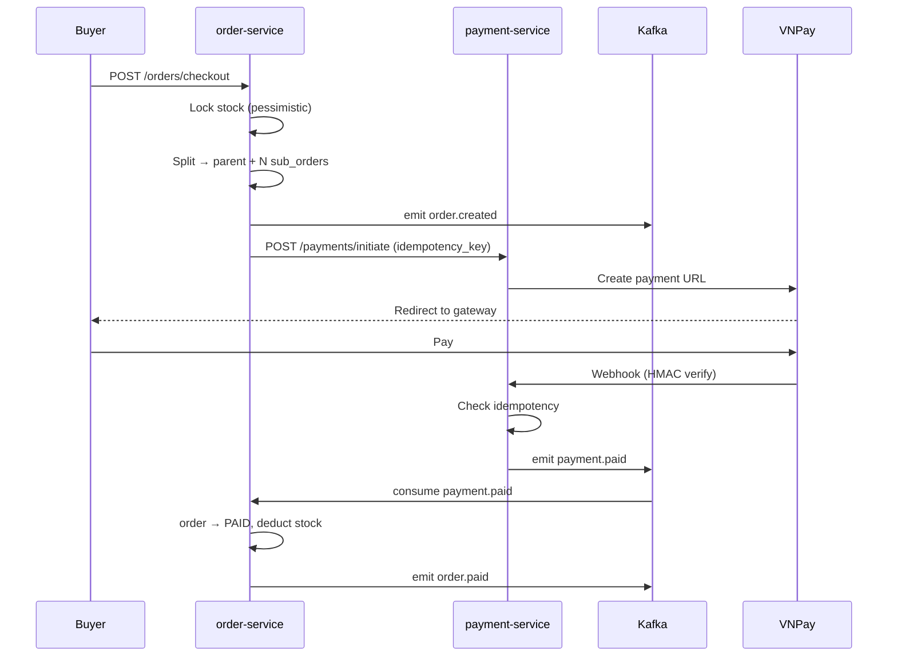
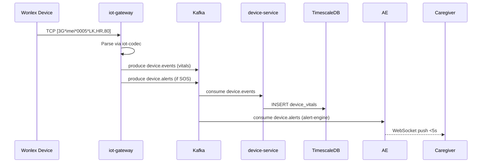
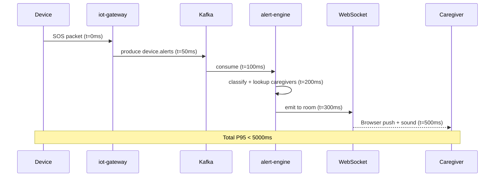

# Phase 1: Xây dựng Lõi Hệ thống (Tuần 7-18)

## Context Links
- `docs/carenest-de-xuat.md` — Section 3 (Zero-base), Section 7 (tính năng 3 cổng), Section 8.1-8.3 (luồng KYC, giao hàng, IoT), Section 10.1-10.4 (kiến trúc + Kafka topics + tiêu chuẩn kỹ thuật), Section 13.2 (lộ trình 30 tuần)
- `docs/carenest-bmc-report.md` — Section 7.1 (Layer 1-3 tech resources), Section 7.2 (Kafka topics), Section 8.1 (Sprint Roadmap S1-S8), Section 8.2 (KYC flow), Section 8.3 (medical review), Section 15.1 (Tech Stack), Section 15.3 (API design)
- `device_simulator/lib/services/wonlex_protocol.dart` — Wonlex packet format `[3G*{deviceId}*{LLLL}*{content}]` (LLLL = 4-hex content length UTF-8). Dùng làm test fixture cho IoT Gateway + Alert Engine
- **Phase 0 deliverables (phụ thuộc)**:
  - Monorepo Turborepo skeleton (services/, apps/, packages/)
  - PostgreSQL 16 + TimescaleDB + Redis 7 + Kafka 3.7 (KRaft) + MeiliSearch trên K8s dev
  - CI/CD GitHub Actions → Docker → K8s dev/staging
  - `packages/iot-codec` (TypeScript port của wonlex_protocol.dart) — parser packet dùng chung cho gateway + simulator
  - ERD sơ bộ + Prisma schema cho tất cả entity
  - OpenTelemetry collector + Grafana/Prometheus đã setup

## Overview
- **Priority**: 🔴 Critical
- **Current Status**: Not Started (waiting for Phase 0)
- **Owner**: CTO + Team Backend (3 Senior) + 1 Frontend Senior (prep only) + 1 IoT Engineer + 1 DevOps
- **Sprints**: 8 sprints × 2 tuần = 16 tuần (Tuần 7-22, bao trùm cả phần đầu Phase 2)
- **Brief Description**: 12 tuần xây dựng 6 backend services cốt lõi (Auth, Catalog, Order, Payment, Device, Alert) + 1 IoT Gateway (Node.js) + 1 Alert Engine worker. Đây là "trái tim" của CareNest — multi-tenant marketplace + IoT health monitoring chạy song song. Output Phase 1 = nền tảng backend production-ready + IoT pipeline end-to-end (device → gateway → Kafka → alert <5s), sẵn sàng để Phase 2 phủ 3 portal Next.js và GHN/Subscription.

## Key Insights
- **Multi-tenant row-level security phải design từ đầu**, retrofit rất đắt: dùng Prisma middleware + `tenant_id` column enforced ở application layer (chưa cần RLS PostgreSQL trong Phase 1 nhưng schema phải sẵn sàng).
- **Cart multi-vendor là NP-hard sub-optimal problem**: dùng greedy heuristic — gom theo `seller_id`, voucher áp theo thứ tự shop-level trước rồi platform-level. Unit test kỹ edge cases (1 seller, N sellers, empty cart, voucher conflict).
- **Alert latency <5s đòi hỏi pipeline đặc biệt**: TCP → in-memory queue (không qua DB write) → Kafka producer (acks=1, batch.size nhỏ) → dedicated Alert Engine consumer với manual commit → WebSocket push. KHÔNG ghi DB trước khi push, ghi async.
- **Wonlex protocol đã có simulator** (`device_simulator/lib/services/wonlex_protocol.dart` + `apps/iot-gateway/../simulator/`) → dùng làm integration test fixture, tăng tốc R&D, không cần đợi thiết bị thật.
- **Idempotency là sống còn cho payment**: webhook VNPay/MoMo retry rất nhiều lần — UNIQUE constraint trên `idempotency_key` column + check trước khi process.
- **Kafka KRaft mode (không ZooKeeper)**: giảm operational overhead, phù hợp team nhỏ Phase 1.
- **Pre-screening tự động (check MST qua API thuế công khai)** giảm 60-70% workload cho Admin reviewer, focus vào edge cases.
- **Pessimistic locking cho inventory** chống overselling tốt hơn optimistic retry trong Phase 1 vì traffic thấp, dễ debug.

## Requirements

### Functional Requirements (FR)

#### Auth & Multi-tenant (Sprint S1)
- FR-1.1: Đăng ký/đăng nhập cho 4 roles: BUYER, SELLER, ADMIN, STAFF (qua email + password, phone optional)
- FR-1.2: JWT access token (15min TTL) + refresh token (30d TTL) với rotation mỗi lần refresh
- FR-1.3: Session management với Redis (key: `session:{user_id}:{session_id}`), admin có thể revoke từ xa
- FR-1.4: MFA bắt buộc cho Admin/Staff (TOTP Google Authenticator, RFC 6238)
- FR-1.5: Multi-tenant isolation: mỗi Seller có `tenant_id` riêng, mọi query filter theo tenant (Prisma middleware)
- FR-1.6: RBAC permission system với 3 cấp: Owner > Manager > Staff (trong cùng seller tenant)
- FR-1.7: Audit log cho mọi auth event (login, logout, register, password_reset, MFA enable/disable, role change)

#### Seller Onboarding + KYC (Sprint S2)
- FR-1.8: Seller đăng ký gian hàng với form KYC: Tên DN, MST, địa chỉ, ngành hàng, người đại diện
- FR-1.9: Upload giấy tờ: GPKD, Giấy phép TTBYT, CCCD người đại diện, catalogue sản phẩm (S3 presigned URL)
- FR-1.10: Pre-screening tự động: validate format (PDF/JPG/PNG, <10MB), check MST qua API thuế công khai (masothue.gdt.gov.vn)
- FR-1.11: Admin review queue với SLA 2 ngày làm việc (tracking `submitted_at` + working_days)
- FR-1.12: Email notification khi approved/rejected với lý do cụ thể (template SES)
- FR-1.13: Seller Health Score (0-100) với 5 metrics: xử lý đơn đúng hạn (30%), điểm đánh giá (25%), tỷ lệ hủy (20%), refund rate (15%), response time (10%)

#### Product Catalog + Medical Review (Sprint S3)
- FR-1.14: Category tree đa cấp (parent-child không giới hạn depth): TTBYT Loại A/B/C/D, vật tư tiêu hao, thiết bị IoT
- FR-1.15: Product CRUD với biến thể (SKU), giá, tồn kho, hình ảnh, mô tả (≥300 từ)
- FR-1.16: Upload hình ảnh (min 5 ảnh, ≥1000×1000px, nền trắng/sản phẩm thật) — S3 + CloudFront CDN
- FR-1.17: Upload tài liệu công bố y tế: số lưu hành BYT, CO, hướng dẫn sử dụng PDF
- FR-1.18: Admin review queue sản phẩm với SLA 1 ngày làm việc, badge "Verified Medical Product"
- FR-1.19: Tự động check số lưu hành với API BYT (csdl.byt.gov.vn) — nếu không có API thì manual verify

#### Cart & Checkout (Sprint S4)
- FR-1.20: Multi-vendor cart: gom hàng từ nhiều seller, lưu Redis backing (TTL 7 ngày)
- FR-1.21: Split order: tự động tách đơn con theo seller khi checkout (1 parent_order_id + N sub_orders)
- FR-1.22: Hold stock tạm thời (10 phút TTL) khi checkout, expire thì release
- FR-1.23: Apply voucher (theo sàn platform-level, theo shop seller-level), conflict resolution
- FR-1.24: Tính phí ship mock trong Phase 1 (table lookup theo khu vực), integrate GHN ở Phase 2
- FR-1.25: Buyer checkout với COD hoặc redirect payment gateway (VNPay/MoMo)
- FR-1.26: Anti-overselling: pessimistic locking (`SELECT ... FOR UPDATE`) trong transaction

#### Payment (Sprint S5)
- FR-1.27: VNPay integration (sandbox trước `sandbox.vnpayment.vn`, production apply ngay Tuần 15)
- FR-1.28: MoMo integration (sandbox `test.momo.vn`, production MoMo Business)
- FR-1.29: Idempotency key cho mỗi transaction (UNIQUE constraint `idempotency_key` column)
- FR-1.30: Webhook callback với HMAC SHA256 signature verify (per gateway)
- FR-1.31: Escrow: giữ tiền 7 ngày sau khi giao hàng (`escrow_release_at` timestamp)
- FR-1.32: Auto reconcile cron job hàng ngày 06:00 (compare payment service vs gateway dashboard)
- FR-1.33: Refund flow (full/partial) với admin approval

#### Order Management + Kafka (Sprint S6)
- FR-1.34: Order lifecycle state machine: `CREATED → PAID → PROCESSING → SHIPPED → DELIVERED → COMPLETED → (REFUNDED | CANCELLED)`
- FR-1.35: Order status transitions với audit log (`order_status_history` table)
- FR-1.36: Sub-order cho mỗi seller (`parent_order_id` FK), seller chỉ thấy sub-order của mình
- FR-1.37: Emit Kafka events: `order.created`, `order.paid`, `order.shipped`, `order.delivered`, `order.cancelled`
- FR-1.38: Order tracking number (placeholder text trong Phase 1, integrate GHN ở Phase 2)
- FR-1.39: Inventory consumer (Kafka) — lắng nghe `order.events` để deduct stock khi PAID, release khi CANCELLED
- FR-1.40: Notification consumer (Kafka) — gửi email xác nhận khi order.paid, order.shipped

#### IoT TCP Gateway (Sprint S7 — song song S6+S8)
- FR-1.41: Node.js TCP server listen port 8000 (configurable qua env `GATEWAY_PORT`)
- FR-1.42: Handle 10,000+ concurrent connections (cluster mode + epoll, scale bằng HPA)
- FR-1.43: Auto-reconnect với exponential backoff cho device (1s → 2s → 4s → ... max 60s)
- FR-1.44: Parse Wonlex V3.2 packets: `[3G*{deviceId}*{LLLL}*{content}]` — port từ `packages/iot-codec`
- FR-1.45: Normalize packet → publish Kafka topic `device.events` (vitals) và `device.alerts` (SOS, fall)
- FR-1.46: Device registry: lưu IMEI, status online/offline, last_seen_at (PostgreSQL `devices` table)
- FR-1.47: Command dispatcher: gửi config từ server xuống device (OTA update, reboot, geofence set)
- FR-1.48: Mock TCP server cho dev/test (`apps/iot-gateway/src/mock-server.ts`)

#### Alert Engine (Sprint S8 — song song S7)
- FR-1.49: Consumer Kafka topic `device.alerts` (consumer group `alert-engine-v1`)
- FR-1.50: Phân loại alert: `sos`, `fall_detected`, `arrhythmia`, `low_battery`, `geofence_breach`
- FR-1.51: Rule-based decision (regex/JSONPath rules trong config) trong Phase 1; ML model ở Phase 2+
- FR-1.52: Latency từ device gửi packet → caregiver nhận push **< 5s** (P95)
- FR-1.53: Multi-channel notification: WebSocket (primary), Web Push (VAPID), SMS fallback (Twilio/ESMS)
- FR-1.54: Alert log lưu vào TimescaleDB hypertable `alerts` (theo `created_at`)

### Non-Functional Requirements (NFR)
- NFR-1.1: Mỗi service phải có health check endpoint `/health` (cho K8s liveness/readiness probe)
- NFR-1.2: API response time P95 < 300ms (CRUD đơn giản), < 1s (aggregate/complex query)
- NFR-1.3: TCP Gateway phải handle 10K concurrent connections với memory < 4GB/instance
- NFR-1.4: Alert latency P95 < 5 giây (đo từ device gửi packet → caregiver nhận push, qua OpenTelemetry trace)
- NFR-1.5: Database queries phải có index cho mọi cột trong WHERE/JOIN/ORDER BY (review trong code review)
- NFR-1.6: Multi-tenant: Mọi query bắt buộc filter theo `tenant_id` (Prisma middleware enforce, test isolation)
- NFR-1.7: Code coverage: unit test ≥70% cho services (auth, payment, alert), ≥50% cho modules khác
- NFR-1.8: OWASP Top 10 security baseline phải pass (Helmet, rate limit, CSRF, SQLi proof via Prisma)
- NFR-1.9: Tất cả sensitive data (PII, health data) phải mã hóa AES-256-GCM (key trong Vault/K8s Secret)
- NFR-1.10: Audit log retention 7 năm (theo Nghị định 13/2023 về bảo vệ dữ liệu cá nhân)
- NFR-1.11: Logging chuẩn JSON format, có `trace_id`, `span_id` (OpenTelemetry)
- NFR-1.12: Distributed tracing (OpenTelemetry) cho cross-service requests (auth → order → payment)

## Architecture

### Services xây dựng trong Phase 1

| # | Service | Port | Responsibilities | Tech | Phụ thuộc |
|---|---------|------|------------------|------|-----------|
| 1 | `auth-service` | 3001 | Register, login, JWT, RBAC, MFA, session, tenant | NestJS + Prisma + Redis | PostgreSQL, Redis |
| 2 | `catalog-service` | 3002 | Categories, products, variants, certificates, medical review | NestJS + Prisma + MeiliSearch | PostgreSQL, MeiliSearch, S3 |
| 3 | `order-service` | 3003 | Cart, checkout, order splitter, inventory lock, lifecycle | NestJS + Prisma + Redis | PostgreSQL, Redis, Kafka |
| 4 | `payment-service` | 3004 | VNPay, MoMo, idempotency, escrow, refund, reconcile | NestJS + Prisma + Redis | PostgreSQL, Redis, Kafka |
| 5 | `device-service` | 3005 | Device registry, vitals query, activation, caregiver | NestJS + Prisma + TimescaleDB | PostgreSQL, TimescaleDB, Kafka |
| 6 | `alert-engine` | 3006 | Kafka consumer `device.alerts`, classify, send push (worker, no HTTP) | NestJS Consumer | Kafka, TimescaleDB, Redis (WS) |
| 7 | `iot-gateway` | 8000 | TCP server, connection manager, packet parser, command dispatch (Node.js thuần) | Node.js + TypeScript | Kafka, Redis, PostgreSQL |

### Database Schema (Phase 1)

Các bảng chính (PostgreSQL + Prisma):
- `users` (id, email, phone, password_hash, role, status, mfa_secret, created_at, updated_at)
- `tenants` (id, name, type, status, created_at) — multi-tenant root
- `sellers` (id, user_id, tenant_id, business_name, tax_code, license_number, status, health_score, kyc_submitted_at, kyc_approved_at)
- `seller_kyc_documents` (id, seller_id, doc_type, file_url, status, reviewed_by, reviewed_at)
- `products` (id, seller_id, tenant_id, name, slug, description, category_id, medical_class, status, approved_at, approved_by)
- `product_variants` (id, product_id, sku, price, stock, attributes JSONB)
- `product_certificates` (id, product_id, certificate_number, issued_by, valid_until, file_url)
- `product_images` (id, product_id, url, sort_order)
- `categories` (id, parent_id, name, slug, medical_class, sort_order) — recursive
- `cart_items` (id, user_id, variant_id, quantity, added_at) — Redis primary, PG async persist
- `orders` (id, user_id, parent_order_id NULL, seller_id NULL, status, total_amount, shipping_fee, discount, idempotency_key, created_at, paid_at, shipped_at, delivered_at)
- `order_items` (id, order_id, variant_id, product_id, quantity, price, subtotal)
- `order_status_history` (id, order_id, from_status, to_status, changed_by, reason, created_at)
- `payments` (id, order_id, gateway, amount, status, idempotency_key UNIQUE, transaction_id, escrow_release_at, created_at)
- `devices` (id, imei UNIQUE, seller_id, user_id NULL, model, status, last_seen_at, activated_at, tenant_id)
- `device_vitals` (id, device_id, ts, heart_rate, spo2, blood_pressure_sys, blood_pressure_dia, temperature, battery, location_lat, location_lng) — **TimescaleDB hypertable**
- `alerts` (id, device_id, type, severity, payload JSONB, created_at, sent_at, channels JSONB) — **TimescaleDB hypertable**
- `subscriptions` (id, user_id, device_id, plan, starts_at, expires_at, status, auto_renew) — schema only in Phase 1
- `caregivers` (id, primary_user_id, caregiver_user_id, relationship, permissions, status, created_at)
- `audit_logs` (id, user_id, action, resource_type, resource_id, payload JSONB, ip_address, user_agent, created_at) — 7 năm retention
- `notifications` (id, user_id, type, channel, payload, status, sent_at) — Phase 1: chỉ email via SES

### Kafka Topics Phase 1

| Topic | Partition Key | Retention | Events | Consumer(s) |
|-------|---------------|-----------|--------|-------------|
| `user.events` | `user_id` | 30d | registered, profile_updated, kyc_submitted, kyc_approved, kyc_rejected | auth-service, notification-consumer |
| `seller.events` | `seller_id` | 30d | registered, approved, rejected, suspended, health_score_changed | catalog-service, notification-consumer |
| `product.events` | `product_id` | 30d | created, updated, approved, rejected, out_of_stock | search-indexer, notification-consumer |
| `order.events` | `order_id` | 90d | created, paid, processing, shipped, delivered, cancelled, refunded | inventory-consumer, notification-consumer, analytics |
| `payment.events` | `order_id` | 90d | initiated, paid, failed, expired, refunded, escrow_held, escrow_released | order-service, notification-consumer |
| `inventory.events` | `sku_id` | 30d | reserved, deducted, released | catalog-service (stock update) |
| `device.events` | `device_id` | 7d | connected, disconnected, vitals_received, location_updated, command_sent | device-service (TimescaleDB), analytics |
| `device.alerts` | `device_id` | 30d | sos, fall_detected, arrhythmia, low_battery, geofence_breach | alert-engine (HIGH PRIORITY) |

### Sequence Diagrams (Mermaid)

**Order Checkout + Escrow:**

**IoT Data Ingestion:**

**Alert Engine <5s pipeline:**

## Related Code Files

### Files cần tạo trong Phase 1

#### Auth Service (`services/auth-service/`)
- `src/main.ts` — NestJS bootstrap, Helmet, CORS, rate limit
- `src/app.module.ts` — import tất cả modules
- `src/auth/auth.controller.ts` — `/auth/register`, `/auth/login`, `/auth/refresh`, `/auth/logout`
- `src/auth/auth.service.ts` — register, login, refresh, validate token
- `src/auth/dto/login.dto.ts`, `register.dto.ts`, `refresh-token.dto.ts`
- `src/auth/strategies/jwt.strategy.ts` — passport-jwt strategy
- `src/auth/guards/jwt-auth.guard.ts`, `roles.guard.ts`, `permissions.guard.ts`
- `src/auth/decorators/roles.decorator.ts`, `current-user.decorator.ts`
- `src/tenants/tenants.service.ts` — tenant lookup, isolation middleware
- `src/mfa/totp.service.ts` — generate secret, verify TOTP (otplib)
- `src/sessions/sessions.service.ts` — Redis session CRUD, revoke
- `src/audit/audit.service.ts` — log auth events
- `prisma/schema.prisma` — User, Tenant, AuditLog models
- `test/auth.e2e-spec.ts`, `test/mfa.e2e-spec.ts`

#### Catalog Service (`services/catalog-service/`)
- `src/categories/categories.service.ts` — tree CRUD, recursive query
- `src/categories/categories.controller.ts`
- `src/products/products.service.ts` — CRUD với variants, status workflow
- `src/products/products.controller.ts` — public + seller + admin endpoints
- `src/products/dto/create-product.dto.ts` — class-validator
- `src/variants/variants.service.ts` — SKU management, stock update
- `src/certificates/certificates.service.ts` — upload + verify
- `src/medical/medical-classifier.ts` — TTBY A/B/C/D lookup theo category
- `src/admin/admin-review.service.ts` — approval queue, SLA tracking
- `src/search/meilisearch-indexer.ts` — async index on product.approved
- `prisma/schema.prisma` — Product, Variant, Category, Certificate
- `test/products.e2e-spec.ts`

#### Order Service (`services/order-service/`)
- `src/cart/cart.service.ts` — Redis-backed cart, TTL 7d
- `src/cart/cart.controller.ts` — `/cart/items` CRUD
- `src/orders/orders.service.ts` — create, split, status transitions
- `src/orders/orders.controller.ts` — `/orders` CRUD
- `src/orders/order-splitter.ts` — multi-vendor split algorithm
- `src/orders/dto/checkout.dto.ts`, `create-order.dto.ts`
- `src/orders/state-machine.ts` — status transition rules
- `src/inventory/inventory.service.ts` — pessimistic lock, hold/release stock
- `src/kafka/order-producer.ts` — emit order.events
- `src/kafka/inventory-consumer.ts` — listen order.paid → deduct stock
- `prisma/schema.prisma` — Order, OrderItem, StatusHistory
- `test/order-splitter.spec.ts` — unit test edge cases (N sellers, empty, voucher)
- `test/checkout.e2e-spec.ts`

#### Payment Service (`services/payment-service/`)
- `src/vnpay/vnpay.service.ts` — create payment URL, verify return URL
- `src/vnpay/vnpay.controller.ts` — `/payments/callback/vnpay` webhook
- `src/momo/momo.service.ts` — MoMo create + verify
- `src/momo/momo.controller.ts` — webhook
- `src/escrow/escrow.service.ts` — hold, release, refund logic
- `src/common/idempotency.service.ts` — middleware check + insert UNIQUE
- `src/common/hmac-verifier.ts` — SHA256 verify per gateway
- `src/refund/refund.service.ts` — full/partial refund
- `src/reconciliation/reconcile.job.ts` — cron 06:00 daily
- `src/kafka/payment-producer.ts`
- `prisma/schema.prisma` — Payment, Refund, Reconciliation
- `test/idempotency.spec.ts` — call 100 lần cùng key = 1 update
- `test/vnpay-webhook.e2e-spec.ts`

#### Device Service (`services/device-service/`)
- `src/devices/devices.service.ts` — registry, activation
- `src/devices/devices.controller.ts` — `/devices/{id}/activate`
- `src/registry/device-registry.service.ts` — IMEI lookup
- `src/vitals/vitals.service.ts` — TimescaleDB hypertable insert + query
- `src/caregivers/caregivers.service.ts` — multi-caregiver
- `src/kafka/vitals-consumer.ts` — consume `device.events` → TimescaleDB
- `prisma/schema.prisma` — Device, Caregiver
- `test/activation.e2e-spec.ts`

#### IoT Gateway (`apps/iot-gateway/`)
- `src/server.ts` — TCP server entry, cluster mode
- `src/connection-manager.ts` — 10K concurrent, epoll
- `src/packet-parser.ts` — wrap `packages/iot-codec` (TS port of wonlex_protocol.dart)
- `src/command-dispatcher.ts` — gửi config xuống device
- `src/kafka/producer.ts` — produce `device.events` + `device.alerts`
- `src/health.ts` — `/health` cho K8s
- `src/mock-server.ts` — dùng cho dev/test
- `package.json` — dependencies: `net`, `kafkajs`, `ioredis`, `@carenest/iot-codec`
- `test/integration.test.ts` — connect 100 devices, send 1000 packets, verify Kafka
- `test/load.test.ts` — 10K connections stress test

#### Alert Engine Worker (`services/alert-engine/`)
- `src/main.ts` — Kafka consumer entry, no HTTP
- `src/alerts/alerts.consumer.ts` — subscribe `device.alerts`
- `src/alerts/alert-classifier.ts` — rule-based (regex/JSONPath)
- `src/alerts/alert-sender.ts` — WebSocket + Web Push
- `src/sos/sos.handler.ts` — highest priority, push all caregivers
- `src/fall/fall-detector.ts` — validate signal pattern
- `src/websocket/websocket-gateway.ts` — Socket.IO server port 3007
- `src/notifications/push.service.ts` — VAPID web-push
- `prisma/schema.prisma` — AlertLog (TimescaleDB)
- `test/latency.spec.ts` — assert P95 < 5s trong test
- `test/sos.e2e-spec.ts`

#### Shared packages (`packages/`)
- `packages/iot-codec/` — TypeScript port của `device_simulator/lib/services/wonlex_protocol.dart` (buildPacket, parsePacket, validate)
- `packages/common-dto/` — shared DTOs (PaginationDto, IdempotencyDto)
- `packages/kafka-client/` — wrapper kafkajs với retry + tracing
- `packages/logger/` — pino + OpenTelemetry context

### Files KHÔNG tạo trong Phase 1
- ❌ Next.js apps (`apps/web-buyer/`, `apps/web-seller/`, `apps/web-admin/`) — Phase 2 S9-S11
- ❌ Subscription Service đầy đủ — chỉ schema + basic CRUD
- ❌ Notification Service riêng (chỉ email trực tiếp từ consumer trong Phase 1)
- ❌ Shipping integration GHN/GHTK — Phase 2
- ❌ ML models cho alert — Phase 2+
- ❌ Mobile apps — Phase 4
- ❌ Analytics dashboard — Phase 3

## Implementation Steps

### Sprint S1 (Tuần 7-8): Auth + Multi-tenant
1. (Backend #1) Setup NestJS skeleton `services/auth-service`, config Prisma + Redis
2. (Backend #1) Implement User entity + Prisma migration, seed 4 roles
3. (Backend #1) Implement `/auth/register`, `/auth/login`, `/auth/logout` với bcrypt
4. (Backend #1) JWT strategy với access (15m) + refresh (30d) rotation, store refresh hash trong DB
5. (Backend #1) RBAC: `RolesGuard` + `PermissionsGuard` + decorators
6. (Backend #1) Session management với Redis (`session:{user_id}:{sid}`), revoke endpoint
7. (Backend #1) Multi-tenant: `TenantContextInterceptor` inject `tenant_id` vào request
8. (Backend #1) MFA TOTP cho Admin (otplib, QR code generation)
9. (Backend #1) Audit log service cho mọi auth event
10. (Backend #1) Unit tests (services) + E2E tests (auth flow)
11. (DevOps) Deploy auth-service lên K8s dev với HPA (2-5 pods), Prometheus scrape
12. (CTO) Code review + merge, demo cho team

### Sprint S2 (Tuần 9-10): Seller Onboarding + KYC
13. (Backend #2) `services/seller-service` (hoặc nằm trong auth-service) — Seller entity + Prisma
14. (Backend #2) KYC document upload: S3 presigned URL, validate PDF/JPG <10MB
15. (Backend #2) Seller registration flow: form → upload → pre-screening
16. (Backend #2) Pre-screening tự động: regex MST (10-13 số), call API thuế (mock nếu public API down)
17. (Backend #2) Admin review queue API: list, approve, reject với reason
18. (Backend #2) Email notification qua SES (template: approved/rejected/needs_more_info)
19. (Backend #2) Seller Health Score job (cron daily 02:00) — 5 metrics
20. (Backend #2) Kafka events: `seller.registered`, `seller.approved`, `seller.rejected`
21. (Backend #2) Unit + E2E tests (full KYC flow với mock admin)

### Sprint S3 (Tuần 11-12): Product Catalog + Medical Review
22. (Backend #3) `services/catalog-service` setup, category tree (parent-child recursive CTE)
23. (Backend #3) Product CRUD với variants (SKU auto-generate nếu không nhập)
24. (Backend #3) Product image upload: S3 + CloudFront, validate ≥1000x1000px
25. (Backend #3) Medical classifier: TTBYT Loại A/B/C/D theo category lookup table
26. (Backend #3) Certificate upload + verify: lưu số lưu hành, CO, hướng dẫn SD
27. (Backend #3) Admin review queue với SLA tracking (working days calculation)
28. (Backend #3) MeiliSearch indexer: async index on `product.approved` Kafka event
29. (Backend #3) Kafka events: `product.created`, `product.approved`, `product.rejected`
30. (Backend #3) Unit + E2E tests (full product lifecycle)

### Sprint S4 (Tuần 13-14): Cart & Checkout
31. (Backend #1) `services/order-service` setup, cart service với Redis backing (key: `cart:{user_id}`)
32. (Backend #1) Order splitter algorithm: gom theo `seller_id`, tách parent + N sub_orders
33. (Backend #1) Checkout flow: hold stock (Redis SETEX 600s) → create orders → return checkout_id
34. (Backend #1) Pessimistic locking cho stock: `SELECT ... FOR UPDATE` trong transaction
35. (Backend #1) Voucher engine: platform-level (code `CARENEST10`) + shop-level (seller-specific)
36. (Backend #1) Shipping fee calculator: mock table theo khu vực (HCM/HN/tỉnh)
37. (Backend #1) Kafka events: `order.created`, emit cho từng sub-order
38. (Backend #1) Unit tests (splitter edge cases) + E2E (full checkout flow)

### Sprint S5 (Tuần 15-16): Payment (VNPay + MoMo)
39. (Backend #2) `services/payment-service` setup, VNPay integration: tạo payment URL (sandbox)
40. (Backend #2) VNPay webhook với HMAC SHA256 verify, extract `idempotency_key` từ `vnp_TxnRef`
41. (Backend #2) MoMo integration: tạo payment URL, IPN callback verify
42. (Backend #2) Idempotency middleware: INSERT ON CONFLICT DO NOTHING + check exist trước
43. (Backend #2) Escrow service: hold khi PAID, schedule release sau 7 ngày
44. (Backend #2) Auto reconcile cron job: so sánh DB vs gateway dashboard daily 06:00
45. (Backend #2) Refund flow: API cho admin approve + execute refund
46. (Backend #2) Kafka events: `payment.paid`, `payment.failed`, `escrow.released`
47. (Backend #2) Unit + E2E tests với sandbox (idempotency 100 calls, HMAC verify)

### Sprint S6 (Tuần 17-18): Order Management + Kafka
48. (Backend #3) Order lifecycle state machine với transition rules (e.g., PAID → PROCESSING chỉ khi stock OK)
49. (Backend #3) Order status transitions với audit log (`order_status_history`)
50. (Backend #3) Sub-order management: seller chỉ thấy sub-order của mình (multi-tenant filter)
51. (Backend #3) Order tracking number: generate UUID placeholder, integrate GHN ở Phase 2
52. (Backend #3) Kafka producer cho order events (re-use từ S4, add ship/delivered)
53. (Backend #3) Inventory consumer: listen `order.paid` → deduct stock, listen `order.cancelled` → release
54. (Backend #3) Notification consumer: listen `order.*` → gửi email xác nhận qua SES
55. (Backend #3) Unit + E2E tests (full lifecycle + Kafka consumer lag)

### Sprint S7 (Tuần 17-18 song song): IoT TCP Gateway
56. (IoT Eng) Setup `apps/iot-gateway` Node.js + TypeScript, cluster mode (PM2 hoặc Node `cluster` API)
57. (IoT Eng) Connection manager: 10K concurrent dùng `net.createServer` + epoll
58. (IoT Eng) Packet parser: import `@carenest/iot-codec` (TS port của wonlex_protocol.dart)
59. (IoT Eng) Device registry: lookup IMEI trong Redis cache → fallback PostgreSQL
60. (IoT Eng) Kafka producer: produce `device.events` (vitals) + `device.alerts` (SOS)
61. (IoT Eng) Command dispatcher: gửi config xuống device (queue per IMEI)
62. (IoT Eng) Integration test với `device_simulator`: chạy 100 simulators, gửi 10K packets
63. (IoT Eng) Performance test: 10K connections, 100 msg/sec, memory <4GB

### Sprint S8 (Tuần 17-18 song song): Alert Engine
64. (Backend #1) `services/alert-engine` setup, Kafka consumer group `alert-engine-v1`
65. (Backend #1) Alert classifier: rule-based config (`config/alert-rules.json`) với regex/JSONPath
66. (Backend #1) SOS handler: highest priority, lookup all caregivers → push to all
67. (Backend #1) Fall detection: validate signal pattern (acceleration > threshold)
68. (Backend #1) Multi-channel sender: WebSocket (Socket.IO) primary + Web Push (VAPID) fallback
69. (Backend #1) Latency monitoring: OpenTelemetry span từ `device.alerts` produce → push, assert P95 <5s
70. (Backend #1) Unit + integration tests (push latency assertion)

### Finalize Phase 1
71. (CTO) End-to-end test: order → payment → IoT activate → SOS alert
72. (CTO) Load test với k6 (1000 req/s API, 10K WebSocket connections)
73. (CTO) Documentation: OpenAPI spec cho tất cả services, runbook cho on-call
74. (CTO) Sprint retrospective + Phase 2 kickoff

## Todo List
- [ ] **S1**: Setup auth-service NestJS skeleton
- [ ] **S1**: User entity + Prisma migration
- [ ] **S1**: Register/Login/Logout endpoints + bcrypt
- [ ] **S1**: JWT strategy (access 15m + refresh 30d rotation)
- [ ] **S1**: RBAC RolesGuard + PermissionsGuard
- [ ] **S1**: Redis session management + revoke
- [ ] **S1**: Multi-tenant TenantContextInterceptor
- [ ] **S1**: MFA TOTP cho Admin
- [ ] **S1**: Audit log service
- [ ] **S1**: Auth unit + E2E tests, deploy lên K8s
- [ ] **S2**: Seller entity + KYC document upload (S3 presigned)
- [ ] **S2**: Pre-screening (MST check, file validate)
- [ ] **S2**: Admin review queue API + SLA tracking
- [ ] **S2**: Email notification (SES) approved/rejected
- [ ] **S2**: Seller Health Score job (5 metrics)
- [ ] **S2**: Kafka events seller.* + tests
- [ ] **S3**: Category tree recursive + Product CRUD
- [ ] **S3**: Variants/SKU + image upload (S3+CDN)
- [ ] **S3**: Medical classifier (TTBYT A/B/C/D)
- [ ] **S3**: Certificate upload + admin review queue
- [ ] **S3**: MeiliSearch indexer + Kafka product events
- [ ] **S4**: Cart service Redis-backed
- [ ] **S4**: Order splitter algorithm + unit tests
- [ ] **S4**: Checkout flow với hold stock 10 phút
- [ ] **S4**: Pessimistic locking + voucher engine
- [ ] **S4**: Shipping fee mock + Kafka order.created
- [ ] **S5**: VNPay sandbox + webhook HMAC verify
- [ ] **S5**: MoMo sandbox + IPN verify
- [ ] **S5**: Idempotency middleware UNIQUE constraint
- [ ] **S5**: Escrow service (hold/release) + reconcile cron
- [ ] **S5**: Refund flow + Kafka payment events
- [ ] **S6**: Order state machine + status history
- [ ] **S6**: Sub-order cho seller + tracking number
- [ ] **S6**: Inventory consumer (Kafka) + notification consumer
- [ ] **S7**: TCP server cluster mode + 10K connections
- [ ] **S7**: Packet parser (iot-codec) + device registry
- [ ] **S7**: Kafka producer + command dispatcher
- [ ] **S7**: Integration test với device_simulator + load test
- [ ] **S8**: Alert consumer + classifier (rule-based)
- [ ] **S8**: SOS + Fall handlers với multi-channel push
- [ ] **S8**: Latency monitoring P95 <5s
- [ ] **Final**: E2E test, load test k6, OpenAPI docs, Phase 2 kickoff

## Success Criteria
- ✅ Auth service deploy production-ready, 99.9% uptime
- ✅ 4 user roles (BUYER/SELLER/ADMIN/STAFF) hoạt động với RBAC enforcement
- ✅ Seller có thể đăng ký + nộp KYC + nhận email approved
- ✅ Product có thể CRUD + admin review + hiển thị trên MeiliSearch
- ✅ Cart multi-vendor split chính xác thành sub-orders (unit test 100% edge cases)
- ✅ Checkout tạo order với hold stock → no overselling (pessimistic lock proven bằng concurrency test)
- ✅ VNPay + MoMo sandbox tích hợp pass E2E test
- ✅ Idempotency: gọi 100 lần cùng key = 1 lần update DB
- ✅ Order lifecycle state machine pass tất cả edge cases (invalid transition rejected)
- ✅ TCP Gateway connect được 10K devices, message loss <0.01%
- ✅ Device simulator từ `device_simulator/` có thể kết nối + gửi packets, gateway parse đúng
- ✅ Alert latency P95 < 5 giây (đo bằng OpenTelemetry distributed tracing)
- ✅ WebSocket push alerts đến caregivers trong <5s
- ✅ Kafka consumer lag < 1000 messages (monitored bằng Grafana)
- ✅ Multi-tenant isolation: Seller A không thấy data Seller B (auto-test 2 tenants)
- ✅ Code coverage ≥70% trên tất cả services
- ✅ OWASP security scan pass (Helmet, rate limit, CSRF)
- ✅ Audit log capture tất cả sensitive actions (auth, KYC, payment, admin)

## Risk Assessment

| # | Rủi ro | XS | TD | Mức | Phòng ngừa | Owner |
|---|--------|-----|-----|------|------------|-------|
| 1 | Order splitter algorithm bug → mất đơn hoặc trùng đơn | TB | Rất cao | 🔴 | Unit test kỹ edge cases (1 seller, N sellers, empty cart, voucher conflict); E2E test concurrent | Backend #1 |
| 2 | VNPay/MoMo sandbox khác production → bug khi go-live | Cao | Cao | 🔴 | Test với cả sandbox + production gateway (small amount 10K VND); staging test trước Phase 3 | Backend #2 |
| 3 | TCP Gateway không handle được 10K connections | TB | Cao | 🟠 | Stress test sớm S7; cluster mode + sticky session; horizontal scaling; plan B: Go rewrite | IoT Eng |
| 4 | Alert latency vượt 5s do bottleneck | Cao | Cao | 🟠 | Design pipeline: in-memory queue bypass DB; pre-warm WebSocket; CDN cho push; monitor P95 từ đầu | Backend #1 |
| 5 | Multi-tenant row-level security có lỗ hổng | TB | Rất cao | 🔴 | Auto-test isolation giữa 2 tenants (pytest); security review; Prisma middleware enforce | CTO + Backend #1 |
| 6 | Kafka cluster down → mất events | Thấp | Rất cao | 🔴 | Replication factor 3; DLQ cho failed events; replay mechanism; monitor lag | DevOps |
| 7 | Prisma query chậm với data lớn | TB | TB | 🟡 | Index đầy đủ; EXPLAIN ANALYZE slow queries; raw SQL cho complex queries | Backend #3 |
| 8 | JWT secret leak → security breach | Thấp | Rất cao | 🟠 | Rotate mỗi 90 ngày; secret manager (Vault); short-lived access token 15m | CTO + DevOps |
| 9 | Device simulator format khác gateway expect | Thấp | TB | 🟡 | Share `packages/iot-codec` (TS port) cho cả 2; integration test tự động | IoT Eng |
| 10 | Pre-screening API thuế không ổn định | Cao | TB | 🟡 | Mock + cache; fallback manual review; rate limit calls | Backend #2 |

## Security Considerations
- **Multi-tenant isolation**: Mọi DB query bắt buộc có `tenant_id` filter, dùng Prisma middleware `query` hook enforce (test tự động 2 tenants truy cập chéo)
- **JWT security**: HS256 với secret trong K8s Secret/Vault, rotate mỗi 90 ngày, refresh token rotation + reuse detection
- **Idempotency**: UNIQUE constraint trên `idempotency_key` column, return same response cho retry (status 200 with cached body)
- **HMAC verify**: Mọi webhook từ payment gateway (VNPay `vnp_SecureHash`, MoMo `signature`) phải verify trước khi process, dùng constant-time compare
- **PII encryption**: Email, phone, address mã hóa AES-256-GCM với key trong Vault, IV random per record
- **Health data**: Vitals lưu trong TimescaleDB riêng (network isolation), mã hóa cột `location_lat/lng` (PDPA sensitive)
- **Audit log**: Tất cả auth + KYC + payment + admin actions log vào `audit_logs`, 7 năm retention, append-only (no UPDATE/DELETE permission)
- **Rate limiting**: 100 req/min cho auth endpoints (login/register), 1000 req/min cho read endpoints (NestJS Throttler + Redis)
- **Input validation**: Tất cả DTO validate với `class-validator` + whitelist, không nhận extra fields
- **SQL injection**: Prisma parameterized queries (safe by default), nhưng review raw queries (`$queryRaw`) kỹ
- **CORS**: Strict whitelist cho 3 portal domains (`web-buyer.carestest.vn`, etc.) + credentials
- **CSP headers**: `helmet` middleware với CSP strict, bảo vệ XSS
- **HTTPS only**: TLS 1.3, HSTS (max-age 1 năm), HPKP backup keys
- **Secrets management**: Tất cả secrets qua K8s Secret + SealedSecrets, không commit `.env`
- **MFA bypass prevention**: Admin không thể disable MFA mà không qua 2nd factor khác

## Next Steps

### Dependencies cho Phase 2 (Tuần 19+)
Phase 2 phụ thuộc các deliverables Phase 1:
- [ ] Auth + RBAC → cần cho Phase 2 admin dashboard (web-admin) + seller portal
- [ ] KYC flow → cần cho Phase 2 seller onboarding UI (web-seller)
- [ ] Product catalog + MeiliSearch → cần cho Phase 2 buyer UI (web-buyer) browse + PDP
- [ ] Cart + Order + Payment → cần cho Phase 2 checkout UI + GHN integration
- [ ] VNPay/MoMo webhook → cần cho Phase 2 webhook testing + monitoring
- [ ] TCP Gateway + Alert Engine → cần cho Phase 2 device activation UI + health dashboard

### Follow-up tasks
- Nếu VNPay production apply chậm (>2 tuần) → dùng MoMo làm primary, COD secondary
- Nếu TCP Gateway không scale đủ 10K → upgrade cluster (PM2 + nginx sticky), nếu vẫn fail → rewrite Go
- Nếu alert latency >5s P95 → optimize pipeline: bỏ Kafka trace trong critical path (direct Redis pub/sub), cache pre-warm WebSocket rooms
- Nếu Prisma chậm → migrate hot tables sang raw SQL + pgBouncer connection pooling

### Handoff sang Phase 2
- CTO brief Phase 2 plan (web-buyer/web-seller/web-admin Next.js 14 + GHN + Subscription)
- Setup shared channel `#phase-2-integration` (Slack/Teams)
- Daily standup tiếp tục với team mở rộng (+1 FE Senior, +1 QA, +1 B2B Sales)
- OpenAPI spec của Phase 1 làm contract cho Phase 2 FE integration
- Demo end-to-end flow cho stakeholders (buyer → seller → admin → caregiver)
