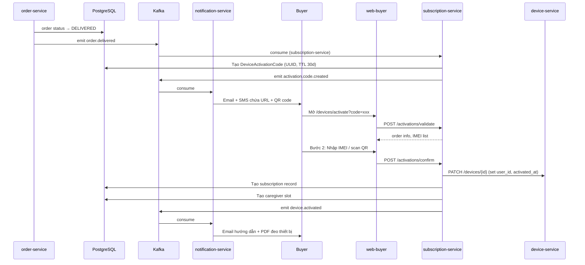
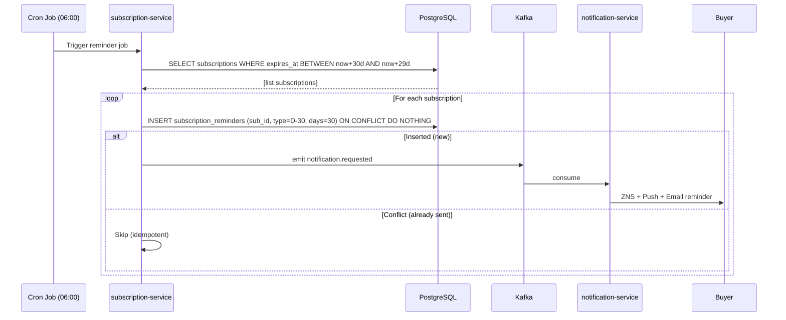
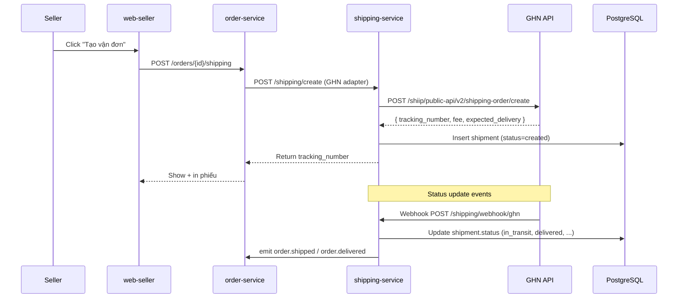
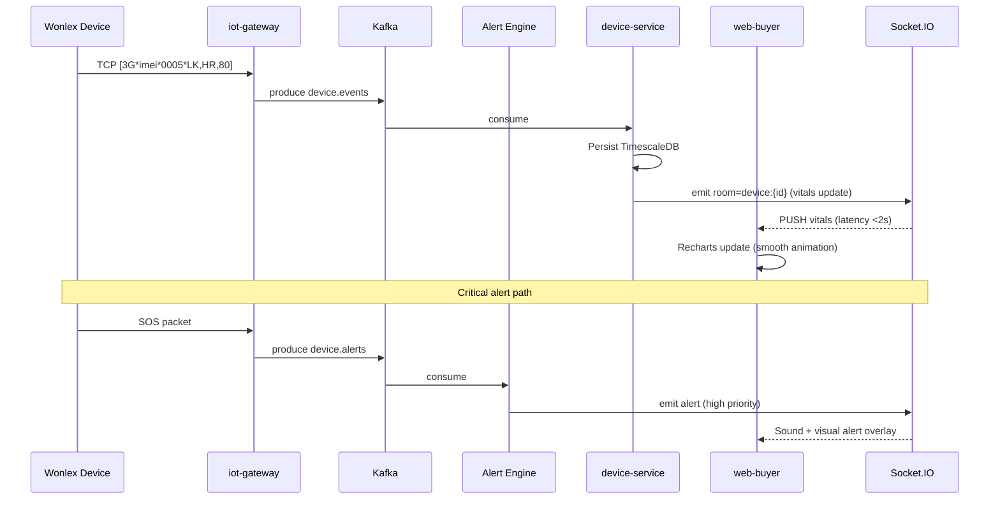

# Phase 2: Tích hợp & Hoàn thiện (Tuần 19–26)

## Context Links
- `docs/carenest-de-xuat.md` — Section 7.1/7.2/7.3 (tính năng 3 cổng), Section 8.1 (luồng Onboarding KYC), Section 8.2 (luồng Đặt hàng + Thanh toán Escrow), Section 8.3 (luồng Giao hàng + Kích hoạt IoT), Section 10.1–10.4 (kiến trúc, Kafka topics, tiêu chuẩn kỹ thuật), Section 13.2 (lộ trình 30 tuần — Giai đoạn 2), Section 13.3 (Deliverables), Section 15 (rủi ro).
- `docs/carenest-bmc-report.md` — Section 8.1 (Sprint Roadmap S9–S13), Section 8.2 (KYC flow), Section 8.4 (Seller Health Score), Section 8.5 (Daily Ops Checklist), Section 12.2/12.3 (Go-to-Market Phase 1–2), Section 13.1/13.2 (KPI Dashboard).
- `device_simulator/CLAUDE.md` & `docs/` — simulator context cho manual QA flow activation.
- **Phase 0 deliverables (phụ thuộc)**: Monorepo Turborepo skeleton, K8s dev/staging, CI/CD GitHub Actions, `packages/iot-codec`, Prisma schema, OpenTelemetry + Grafana/Prometheus, System Design Doc, đăng ký merchant VNPay/MoMo (đã apply), DPIA đã nộp.
- **Phase 1 deliverables (phụ thuộc)**: 6 services NestJS (auth, catalog, order, payment, device, alert-engine) + IoT Gateway + Alert Engine + ERD + Kafka topics + Socket.IO + MeiliSearch đã live trên K8s staging. Frontend 1 Senior đã prep design system skeleton.

## Overview
- **Priority**: 🔴 Critical (block Phase 3 pilot)
- **Current Status**: Not Started (waiting for Phase 1 S5–S8 complete)
- **Owner**: CTO + 2 Frontend Senior (mới hire tuần 18) + 2 Frontend Junior (mới hire tuần 19) + 2 Backend Senior + 1 IoT Engineer + 1 DevOps + 1 Designer + 1 PM
- **Sprints**: 5 sprints × 2 tuần = 10 tuần (Tuần 19–28, đệm 2 tuần cho polish cuối)
- **Brief Description**:
  8–10 tuần build 3 cổng Next.js 14 (web-buyer, web-seller, web-admin) từ shared design system + API client, tích hợp GHN/GHTK shipping, hoàn thiện cổng thanh toán VNPay Escrow + thêm ZaloPay, xây Notification Service (email + Web Push + SMS + Zalo ZNS), xây Subscription Service với auto-reminder D-30/15/7/3 và grace period, hoàn thiện Device Activation Bridge (QR scan → IMEI link → subscription created) và Health Dashboard real-time cho buyer. Output = sản phẩm end-to-end có thể demo cho 10–15 pilot sellers vào Phase 3.

## Key Insights
- **Frontend 3 portals có ~80% shared components** (Button, Input, Modal, Table, Form, Toast, Skeleton, Pagination, DatePicker) → tận dụng `packages/ui/` trong monorepo, sinh design token Tailwind preset `packages/tailwind-preset/`, cùng `packages/api-client/` typed (auto-generated từ OpenAPI của Phase 1 services) → giảm 40–50% effort so với build 3 codebase độc lập.
- **Device activation là USP cốt lõi của CareNest** (commerce → IoT bridge) — UX wizard 3 bước phải tối ưu cho người cao tuổi (font lớn, contrast cao, ít bước, có hotline fallback). Bất kỳ drop-off >20% tại bước nào = pilot thất bại.
- **Subscription auto-reminder là retention lever quan trọng nhất** (SaaS MRR 99k–199k/tháng) — cron job phải có **idempotency key = (subscription_id, reminder_type, days_before)** với UNIQUE constraint trong `subscription_reminders` table, tránh gửi trùng khi redeploy hoặc multi-instance.
- **GHN/GHTK API wrapper trong Adapter pattern** vì cả 2 bên thường xuyên đổi version, response shape không ổn định. Phase 2 chỉ cần 1 primary (GHN) + 1 backup (GHTK), nhưng kiến trúc adapter chuẩn bị cho VNPost/Viettel Post sau này.
- **Zalo ZNS template approval kéo dài 2–4 tuần** (do Zalo duyệt thủ công từng template) → apply sớm tuần 21, fallback email + Web Push + SMS ngay từ đầu để không bị chặn. Notification dispatcher dùng channel-priority strategy: ZNS > Push > SMS > Email.
- **Wonlex simulator (`device_simulator/`)** là test fixture hoàn hảo cho Health Dashboard — khi buyer kích hoạt IMEI, dùng simulator sinh vitals giả để test real-time chart & alert timeline trên web-buyer mà không cần thiết bị thật.

## Requirements

### Functional Requirements (FR)

#### Frontend web-buyer (Next.js 14, App Router)
- **FR-2.1**: Homepage với hero banner, featured products carousel, category grid, health tips blog preview, SEO-optimized.
- **FR-2.2**: Product Listing Page (PLP) `/products` với filter (category, price, brand, medical class, certificate), sort (relevance, price, newest), pagination infinite scroll.
- **FR-2.3**: Product Detail Page (PDP) `/products/[slug]` với image gallery (zoom, swipe), mô tả đầy đủ, certificate info, reviews & ratings, Q&A.
- **FR-2.4**: Search `/search` với MeiliSearch integration, autocomplete dropdown, typo tolerance, highlight match.
- **FR-2.5**: Cart `/cart` multi-vendor (gom theo seller), edit qty/remove, apply voucher (shop-level + platform-level).
- **FR-2.6**: Checkout flow `/checkout` 4 bước: address → shipping (GHN fee) → payment (VNPay/MoMo/ZaloPay/COD) → review.
- **FR-2.7**: Order confirmation `/orders/[id]` + tracking timeline với GHN realtime webhook.
- **FR-2.8**: User profile `/profile` (info, addresses, payment methods, notification prefs, security).
- **FR-2.9**: **Health Dashboard** `/devices/[id]` (USP!): real-time vitals (HR, SpO2, BP, temp) charts theo ngày/tuần/tháng (Recharts), GPS location map, alert timeline (SOS, fall, arrhythmia, low_battery, geofence_breach), multi-caregiver panel.
- **FR-2.10**: **Device Activation Wizard** `/devices/activate` (USP!): 3 bước — chọn đơn hàng → nhập IMEI hoặc scan QR → chọn subscription plan + payment.
- **FR-2.11**: Subscription management `/subscription` (xem gói hiện tại, payment history, gia hạn, hủy, upgrade/downgrade).
- **FR-2.12**: Help Center `/help` + Live chat (Zalo OA embed widget) + FAQ searchable.
- **FR-2.13**: PWA: `manifest.json` + service worker cho offline basic, "Add to Home Screen" trên mobile.

#### Frontend web-seller (Next.js 14, App Router)
- **FR-2.14**: Seller Dashboard `/dashboard`: doanh thu chart (Recharts), đơn hàng pending, tồn kho thấp, health score badge, payout upcoming.
- **FR-2.15**: KYC submission `/kyc` (multi-step form: business info → upload docs → submit, status tracker với email notification).
- **FR-2.16**: Product Management `/products` (CRUD table), `/products/new` (form đầy đủ: images, variants, price, certificate, medical class), `/products/[id]/edit`.
- **FR-2.17**: Inventory Management `/inventory` (IMEI/Device ID import CSV, mapping với variants, search/filter).
- **FR-2.18**: Order Management `/orders` (danh sách, filter, xử lý: confirm → pack → ready-to-ship).
- **FR-2.19**: Shipping `/shipping` (tạo vận đơn GHN ngay từ order detail, in phiếu A5/A6, tracking realtime).
- **FR-2.20**: Reports `/reports` (doanh thu theo ngày/tuần/tháng, top sản phẩm, conversion rate, refund rate).
- **FR-2.21**: Subscription revenue share `/subscription-share` (doanh thu từ gói giám sát, breakdown theo sản phẩm).
- **FR-2.22**: Payouts `/payouts` (history, upcoming, bank account, chi tiết sao kê).
- **FR-2.23**: Customer support tickets `/support` (xem ticket từ buyer, reply qua email, internal note, status).
- **FR-2.24**: Settings `/settings` (shop info, bank account, notification prefs, API keys cho tích hợp ngoài).

#### Frontend web-admin (Next.js 14, App Router)
- **FR-2.25**: Admin Dashboard `/dashboard` với KPI cards: GMV hôm nay/tuần/tháng, sellers active, devices online, alerts today, payment success rate.
- **FR-2.26**: Seller Approval Queue `/sellers/approval` (danh sách KYC pending, xem docs, approve/reject với lý do + email template).
- **FR-2.27**: Product Review Queue `/products/review` (danh sách SKU pending, xem certificate, approve/reject).
- **FR-2.28**: User Management `/users` (search, view profile, ban/unban, role change, impersonate cho debug).
- **FR-2.29**: Order Management `/orders` (all orders cross-tenant, manual intervention, force status change có audit).
- **FR-2.30**: Device Management `/devices` (online/offline realtime, manual command: reboot, OTA trigger, geofence set).
- **FR-2.31**: Payment Management `/payments` (reconcile dashboard, manual refund, gateway transaction search).
- **FR-2.32**: Voucher/Promotion Management `/vouchers` (tạo mã giảm giá, theo dõi sử dụng, scope platform/shop).
- **FR-2.33**: Audit Log Viewer `/audit-logs` (search theo actor/action/resource/date, filter, export CSV, immutable view).
- **FR-2.34**: System Health `/system-health` (Grafana embed iframe cho Kafka lag, DB connections, Redis memory, alert latency P95).
- **FR-2.35**: KOL content management `/content` (blog, health tips CRUD, scheduled publish).

#### Tích hợp Đối tác & Bên ngoài
- **FR-2.36**: GHN API: tạo vận đơn (`/shiip/public-api/v2/shipping-order/create`), tracking (`/v2/shipping-order/detail`), cancel, webhook callback.
- **FR-2.37**: GHTK API: backup provider, tạo vận đơn, tracking (auto-failover nếu GHN 5xx liên tiếp 3 lần).
- **FR-2.38**: Zalo ZNS API: gửi notification cảnh báo y tế (template "SOS_ALERT", "FALL_DETECTED", "ORDER_DELIVERED").
- **FR-2.39**: Web Push với VAPID (generate keypair, subscribe qua Service Worker, push từ Notification Service).
- **FR-2.40**: SMS qua ESMS.vn: fallback khi push fail, OTP login, critical alerts.
- **FR-2.41**: Email qua AWS SES: order confirmation, KYC status, device activation guide, subscription reminder.
- **FR-2.42**: ZaloPay bổ sung: thêm cổng thanh toán (Phase 1 chỉ có VNPay + MoMo).

#### Device Activation Bridge
- **FR-2.43**: Khi order status → `DELIVERED`: tạo `DeviceActivationCode` (UUID signed, TTL 30 ngày), lưu `order_id`, `imei_list` (nếu seller đã scan), `user_id`.
- **FR-2.44**: Auto gửi email + SMS cho buyer chứa URL `/devices/activate?code={token}` và QR code PNG (generate bằng `qrcode` library).
- **FR-2.45**: Buyer truy cập URL → wizard 3 bước (FR-2.10) → validate code → link `order_id` + `device_id` + `user_id` trong `devices` table (set `user_id`, `activated_at`).
- **FR-2.46**: Tạo subscription record theo gói đã mua (Basic 99k hoặc Family 249k) trong `subscriptions` table, set `starts_at = now`, `expires_at = now + 30 days`.
- **FR-2.47**: Tạo Caregiver slot cho buyer (`primary_user_id = buyer`, `caregiver_user_id = buyer`, `relationship = "self"`, `permissions = ["view_vitals", "receive_alerts"]`).
- **FR-2.48**: Gửi email hướng dẫn đeo thiết bị + sử dụng + link vào Health Dashboard (PDF đính kèm).
- **FR-2.49**: Audit log mọi event kích hoạt (actor, action=ACTIVATE, resource=device, before/after state, IP).

#### Subscription Management
- **FR-2.50**: 3 gói: Basic 99k/tháng (1 device, 1 caregiver, lưu 6 tháng vitals), Family 249k/tháng (3 devices, 5 caregivers, 12 tháng vitals, weekly report), Enterprise (B2B pricing theo yêu cầu).
- **FR-2.51**: One-click renewal với payment token đã lưu (VNPay tokenization), skip re-enter card.
- **FR-2.52**: Cron job `subscription-reminder.job.ts` chạy daily 06:00 ICT: scan subscriptions expires trong 30/15/7/3 ngày, tạo `subscription_reminders` record (UNIQUE subscription_id + reminder_type + days_before).
- **FR-2.53**: Auto-send reminder qua email + Web Push + Zalo ZNS (priority: ZNS > Push > Email).
- **FR-2.54**: Grace period 3 ngày sau `expires_at` — subscription status = `grace_period`, device vẫn hoạt động.
- **FR-2.55**: Auto-suspend device khi `now > expires_at + 3 days` và chưa gia hạn → set device `status = SUSPENDED`, block vitals ingestion, gửi final notice.
- **FR-2.56**: Refund partial cho yearly subscription (prorated theo tháng còn lại), admin approval required.
- **FR-2.57**: Upgrade Basic → Family: prorated charge phần chênh lệch; downgrade Family → Basic: không refund, áp dụng từ kỳ tiếp theo.
- **FR-2.58**: Proration calculator service với unit test edge cases (mid-cycle upgrade, refund trong grace period).

### Non-Functional Requirements (NFR)
- **NFR-2.1**: Frontend Core Web Vitals: LCP < 2.5s, FID (INP) < 100ms, CLS < 0.1 (đo bằng Lighthouse CI trong GitHub Actions).
- **NFR-2.2**: SEO: mỗi PDP phải có `<title>`, `<meta description>`, OpenGraph (og:title, og:image, og:price), Twitter Card, schema.org/Product JSON-LD.
- **NFR-2.3**: Mobile responsive: 320px → 2560px (3 breakpoints: mobile 320–767, tablet 768–1023, desktop ≥1024), sử dụng Tailwind responsive utilities.
- **NFR-2.4**: i18n: dùng `next-intl` cho Tiếng Việt trước (mặc định), English fallback; routing `/vi/...` và `/en/...`; copy externalized trong `messages/{locale}/*.json`.
- **NFR-2.5**: Accessibility: WCAG 2.1 AA — keyboard navigation, ARIA labels, color contrast ≥4.5:1, focus visible, screen reader test với NVDA.
- **NFR-2.6**: Real-time dashboard update latency < 2s end-to-end (device gửi → buyer thấy), dùng Socket.IO với room = `device:{device_id}`.
- **NFR-2.7**: Cron jobs phải có idempotency: mỗi job scan qua `subscription_reminders` UNIQUE constraint `(subscription_id, reminder_type, days_before)` → nếu đã tồn tại thì skip.
- **NFR-2.8**: GHN API timeout 10s, retry 3 lần exponential backoff (1s, 2s, 4s), nếu vẫn fail → queue retry job (BullMQ) + alert admin.
- **NFR-2.9**: WebSocket auto-reconnect với exponential backoff (1s, 2s, 4s, 8s, max 30s), heartbeat ping mỗi 25s, fallback HTTP polling mỗi 30s nếu WS fail 3 lần.
- **NFR-2.10**: Lighthouse score ≥ 90 cho buyer homepage (Performance, Accessibility, Best Practices, SEO), ≥ 85 cho PDP/PLP.
- **NFR-2.11**: Bundle size: mỗi page < 200KB JS gzipped (dùng `@next/bundle-analyzer`, dynamic import cho charts/maps).
- **NFR-2.12**: All API calls có `X-Request-Id` header (UUID v7) cho distributed tracing (OpenTelemetry), response mirror về cho client để log.
- **NFR-2.13**: P95 API response time < 500ms cho CRUD đơn giản, < 2s cho Health Dashboard aggregate query.
- **NFR-2.14**: Image optimization: Next.js `<Image>` component, WebP/AVIF auto, lazy load, blur placeholder.
- **NFR-2.15**: Service Worker caching: cache static assets 30 ngày, API responses stale-while-revalidate 60s, offline fallback page.

## Architecture

### Frontend Structure (Monorepo `apps/`)
```
apps/
├── web-buyer/                    # Next.js 14 (App Router, port 4000)
│   ├── app/
│   │   ├── (marketing)/          # Homepage, blog, /search, /help
│   │   ├── (shop)/               # /products, /products/[slug]
│   │   ├── (account)/            # /profile, /orders, /subscription
│   │   ├── (devices)/            # /devices, /devices/[id], /devices/activate
│   │   ├── (checkout)/           # /cart, /checkout
│   │   └── api/                  # BFF routes (proxy, server actions)
│   ├── components/               # UI components
│   │   ├── ui/                   # Design system (Button, Input, Card...)
│   │   ├── product/              # ProductCard, ProductGrid, ImageGallery
│   │   ├── checkout/             # CheckoutForm, PaymentMethod
│   │   ├── dashboard/            # HealthChart, AlertTimeline, MapView
│   │   ├── activation/           # ActivationWizard, QRScanner
│   │   └── shared/               # Header, Footer, SearchBar, CartIcon
│   ├── lib/
│   │   ├── api/                  # API client (re-export từ packages/api-client)
│   │   ├── hooks/                # useWebSocket, useCart, useAuth
│   │   └── utils/                # format, validate
│   ├── public/                   # Static assets, icons, manifest.json
│   ├── next.config.js
│   └── tailwind.config.ts        # extend từ packages/tailwind-preset
├── web-seller/                   # Next.js 14 (port 4001) - cấu trúc tương tự
└── web-admin/                    # Next.js 14 (port 4002) - cấu trúc tương tự
```

### Shared Design System (`packages/`)
- `packages/ui/` — React components dùng chung (Button, Input, Modal, Table, Form, Toast, Card, Skeleton, Pagination, DatePicker, Select, Tabs) + Storybook.
- `packages/tailwind-preset/` — color tokens, spacing, typography scale, breakpoints.
- `packages/api-client/` — typed API client auto-generated từ OpenAPI specs của Phase 1 services, có auth interceptor + request ID injection.
- `packages/eslint-config-custom/` — share ESLint rules.
- `packages/tsconfig/` — share TypeScript config (strict mode).

### Notification Service (NestJS - mới trong Phase 2)
```
services/notification-service/src/
├── main.ts                       # Bootstrap, port 3007
├── app.module.ts                 # Import tất cả modules
├── email/
│   ├── email.service.ts          # AWS SES client
│   ├── email.controller.ts       # Health check
│   └── templates/                # Handlebars (.hbs): order_confirm, kyc_status, activation_guide, renewal_reminder
├── push/
│   ├── push.service.ts           # Web Push library (web-push npm)
│   └── vapid-keys.ts             # Generate + cache keypair
├── sms/
│   └── sms.service.ts            # ESMS.vn client
├── zalo/
│   ├── zalo-zns.service.ts       # Zalo ZNS API
│   └── zalo-oa.service.ts        # Zalo OA (cho live chat link)
├── templates/
│   └── templates.service.ts      # Render Handlebars template
├── dispatcher/
│   └── notification-dispatcher.service.ts  # Multi-channel routing theo priority
└── kafka/
    └── notification-consumer.ts  # Listen `notification.requests` topic
```

### Subscription Service (NestJS - mới trong Phase 2)
```
services/subscription-service/src/
├── main.ts                       # Port 3008
├── app.module.ts
├── plans/
│   ├── plans.service.ts          # CRUD plans
│   └── plans.controller.ts
├── subscriptions/
│   ├── subscriptions.service.ts  # Create, renew, cancel, upgrade, downgrade
│   ├── subscriptions.controller.ts
│   └── proration-calculator.ts   # Prorated charge/refund
├── payment/
│   ├── subscription-payment.service.ts
│   └── auto-renew.service.ts     # Charge payment token
├── cron/
│   ├── reminder.job.ts           # 06:00 daily, scan D-30/15/7/3
│   ├── grace-period.job.ts       # 06:30 daily, mark grace period
│   └── suspend-expired.job.ts    # 07:00 daily, auto-suspend > grace
└── kafka/
    └── subscription-consumer.ts  # Listen `order.events` (DELIVERED) → trigger activation flow
```

### Shipping Service (NestJS - mới trong Phase 2)
```
services/shipping-service/src/
├── main.ts                       # Port 3009
├── app.module.ts
├── ghn/
│   ├── ghn.service.ts            # Create order, tracking, cancel
│   ├── ghn.controller.ts         # Webhook /shipping/webhook/ghn
│   └── ghn.adapter.ts            # Adapter pattern: implement IShippingProvider
├── ghtk/
│   ├── ghtk.service.ts           # Backup provider
│   └── ghtk.adapter.ts
├── adapter/
│   ├── shipping-provider.interface.ts  # IShippingProvider contract
│   └── shipping.factory.ts       # Chọn provider theo config
├── tracking/
│   └── tracking.service.ts       # Realtime tracking aggregator
└── cron/
    └── sync-tracking.job.ts      # Mỗi 30 phút sync tracking cho orders in_transit
```

### Sequence Diagrams (Mermaid)

**Device Activation Flow:**


**Subscription Auto-Renewal Reminder (Idempotent):**


**GHN Create Order + Tracking Webhook:**


**Health Dashboard Real-time (WebSocket):**


## Related Code Files

### Files cần tạo trong Phase 2 (chi tiết)

#### `apps/web-buyer/` (Next.js 14)
- `package.json`, `next.config.js`, `tailwind.config.ts`, `tsconfig.json`, `middleware.ts` (auth + i18n)
- `app/layout.tsx` (root layout với i18n provider, theme, fonts)
- `app/(marketing)/page.tsx` (homepage)
- `app/(marketing)/blog/page.tsx`, `app/(marketing)/blog/[slug]/page.tsx`
- `app/(shop)/products/page.tsx` (PLP với search params)
- `app/(shop)/products/[slug]/page.tsx` (PDP với generateMetadata cho SEO)
- `app/(shop)/search/page.tsx`
- `app/(checkout)/cart/page.tsx`
- `app/(checkout)/checkout/page.tsx` (multi-step form với React Hook Form + Zod)
- `app/(account)/profile/page.tsx`
- `app/(account)/orders/page.tsx`, `app/(account)/orders/[id]/page.tsx`
- `app/(account)/subscription/page.tsx`
- `app/(devices)/devices/page.tsx` (danh sách devices đã kích hoạt)
- `app/(devices)/devices/[id]/page.tsx` (**Health Dashboard** với Recharts + Map)
- `app/(devices)/devices/activate/page.tsx` (**Activation Wizard** 3 bước)
- `app/api/webhook/vnpay/route.ts` (server-side payment webhook)
- `components/ui/*` (re-export từ packages/ui)
- `components/product/ProductCard.tsx`, `ProductGrid.tsx`, `ImageGallery.tsx`, `ReviewList.tsx`
- `components/checkout/CheckoutForm.tsx`, `AddressForm.tsx`, `ShippingMethod.tsx`, `PaymentMethod.tsx`
- `components/dashboard/HealthChart.tsx` (Recharts wrapper), `AlertTimeline.tsx`, `MapView.tsx` (Leaflet), `CaregiverPanel.tsx`, `DeviceStatusBadge.tsx`
- `components/activation/ActivationWizard.tsx`, `QRScanner.tsx` (html5-qrcode), `IMEIInput.tsx`, `PlanSelector.tsx`
- `components/shared/Header.tsx`, `Footer.tsx`, `SearchBar.tsx` (với MeiliSearch autocomplete), `CartIcon.tsx`, `NotificationBell.tsx`
- `lib/api/products.ts`, `orders.ts`, `devices.ts`, `subscriptions.ts`, `auth.ts`
- `lib/hooks/useWebSocket.ts`, `useCart.ts` (Zustand), `useAuth.ts`, `useDebounce.ts`
- `lib/utils/format.ts` (VND, date), `lib/utils/validators.ts` (IMEI checksum Luhn)
- `messages/vi/common.json`, `messages/en/common.json` (i18n)
- `public/manifest.json`, `public/sw.js` (service worker cho PWA)

#### `apps/web-seller/` (Next.js 14)
- `app/dashboard/page.tsx` (KPI cards + Recharts revenue chart)
- `app/kyc/page.tsx` (multi-step KYC form)
- `app/products/page.tsx` (table), `app/products/new/page.tsx`, `app/products/[id]/edit/page.tsx`
- `app/inventory/page.tsx` (IMEI CSV import, table)
- `app/orders/page.tsx`, `app/orders/[id]/page.tsx` (order detail + create shipping)
- `app/shipping/page.tsx` (GHN create + print label)
- `app/reports/page.tsx`, `app/subscription-share/page.tsx`, `app/payouts/page.tsx`
- `app/support/page.tsx`, `app/settings/page.tsx`
- `components/...` (mirror web-buyer structure)

#### `apps/web-admin/` (Next.js 14)
- `app/dashboard/page.tsx` (KPI overview)
- `app/sellers/approval/page.tsx` (queue + review modal)
- `app/products/review/page.tsx`
- `app/users/page.tsx`, `app/orders/page.tsx`, `app/devices/page.tsx`
- `app/payments/page.tsx`, `app/vouchers/page.tsx`, `app/audit-logs/page.tsx` (với CSV export)
- `app/system-health/page.tsx` (Grafana iframe embed)
- `app/content/page.tsx` (blog CMS)
- `components/...` (admin-specific: DataTable, KYCViewer, CertificateViewer, RefundModal)

#### `packages/ui/` (Shared Design System)
- `src/Button.tsx` (variants: primary, secondary, ghost, danger, sizes: sm/md/lg)
- `src/Input.tsx`, `src/Select.tsx`, `src/DatePicker.tsx` (react-day-picker)
- `src/Modal.tsx`, `src/Drawer.tsx`, `src/Tabs.tsx`
- `src/Table.tsx` (sortable, paginated, column resize), `src/Pagination.tsx`
- `src/Form.tsx` (FormProvider wrapper), `src/Toast.tsx` (sonner)
- `src/Card.tsx`, `src/Skeleton.tsx`, `src/Badge.tsx`, `src/Avatar.tsx`
- `src/EmptyState.tsx`, `src/ErrorBoundary.tsx`
- `src/index.ts` (barrel export)
- `tailwind.config.js` (theme tokens: brand colors, semantic colors, spacing scale)
- `package.json` (peer deps: react, tailwindcss, framer-motion, react-hook-form, zod)
- `tsconfig.json`

#### `packages/api-client/` (Typed API Client)
- `src/auth.ts` (login, register, refresh, me)
- `src/products.ts`, `src/orders.ts`, `src/payments.ts`
- `src/devices.ts`, `src/subscriptions.ts`, `src/shipments.ts`
- `src/kyc.ts`, `src/notifications.ts`
- `src/index.ts` (barrel)
- `src/client.ts` (axios instance với auth interceptor + request ID injection)
- `scripts/generate.ts` (openapi-typescript từ mỗi service URL)

#### `services/notification-service/` (NestJS - mới)
- `src/main.ts`, `src/app.module.ts`
- `src/email/email.service.ts` (SES client, send templated email)
- `src/email/templates/*.hbs` (Handlebars: order-confirm, kyc-approved, device-activated, renewal-reminder, payment-failed)
- `src/push/push.service.ts` (web-push library)
- `src/push/vapid-keys.ts` (generate + cache 1 lần)
- `src/sms/sms.service.ts` (ESMS.vn HTTP client)
- `src/zalo/zalo-zns.service.ts` (Zalo ZNS API)
- `src/templates/templates.service.ts` (compile + render Handlebars)
- `src/dispatcher/notification-dispatcher.service.ts` (channel priority routing)
- `src/kafka/notification-consumer.ts` (lắng nghe `notification.requests` topic)
- `prisma/schema.prisma` (NotificationLog, PushSubscription)
- `test/notification-dispatcher.spec.ts` (channel fallback logic)

#### `services/subscription-service/` (NestJS - mới)
- `src/main.ts`, `src/app.module.ts`
- `src/plans/plans.service.ts`, `src/plans/plans.controller.ts`, `src/plans/dto/*.ts`
- `src/subscriptions/subscriptions.service.ts` (create, renew, cancel, upgrade, downgrade)
- `src/subscriptions/subscriptions.controller.ts`
- `src/subscriptions/proration-calculator.ts` (pure function, unit test nhiều edge cases)
- `src/payment/subscription-payment.service.ts` (charge payment token)
- `src/payment/auto-renew.service.ts` (retry logic với idempotency key)
- `src/cron/reminder.job.ts` (06:00 daily, idempotent với UNIQUE constraint)
- `src/cron/grace-period.job.ts` (06:30 daily)
- `src/cron/suspend-expired.job.ts` (07:00 daily)
- `src/kafka/subscription-consumer.ts` (lắng nghe `order.events` → trigger activation)
- `prisma/schema.prisma` (Subscription, Plan, SubscriptionReminder, PaymentToken)
- `test/proration.spec.ts` (≥20 edge cases)
- `test/reminder-job.spec.ts` (idempotency test)

#### `services/shipping-service/` (NestJS - mới)
- `src/main.ts`, `src/app.module.ts`
- `src/adapter/shipping-provider.interface.ts` (IShippingProvider contract: createOrder, track, cancel)
- `src/adapter/shipping.factory.ts` (config-driven provider selection)
- `src/ghn/ghn.service.ts`, `src/ghn/ghn.adapter.ts`, `src/ghn/ghn.controller.ts` (webhook)
- `src/ghtk/ghtk.service.ts`, `src/ghtk/ghtk.adapter.ts`
- `src/tracking/tracking.service.ts` (realtime aggregator)
- `src/cron/sync-tracking.job.ts` (sync orders in_transit mỗi 30 phút)
- `prisma/schema.prisma` (Shipment, ShipmentEvent)
- `test/ghn-adapter.spec.ts` (mock GHN responses)

### Files KHÔNG tạo trong Phase 2
- ❌ Mobile native apps (React Native) — Phase 4
- ❌ AI/ML recommendation engine — Phase 4
- ❌ B2B Enterprise portal riêng — Phase 4
- ❌ Insurance integration — Phase 4+
- ❌ Telemedicine partnership (bác sĩ online) — Phase 4+
- ❌ Thuốc kê đơn (Rx) — Phase 5+ (cần giấy phép đặc biệt)

## Implementation Steps

### Sprint S9 (Tuần 19–20): web-seller MVP + GHN + Notification skeleton
1. **(Frontend #1)** Setup Next.js 14 skeleton cho `web-seller` (app router, Tailwind, TypeScript strict).
2. **(Frontend #1)** Setup shared `packages/ui` — Button, Input, Card, Table, Form, Toast, Skeleton, Pagination.
3. **(Frontend #1)** Setup `packages/api-client` generated từ OpenAPI (auth, catalog, order, payment của Phase 1).
4. **(Frontend #1)** `web-seller` Dashboard page (KPI cards, Recharts revenue chart).
5. **(Frontend #1)** `web-seller` KYC submission flow (multi-step form với upload).
6. **(Frontend #1)** `web-seller` Product CRUD UI (table, form, image upload).
7. **(Frontend #1)** `web-seller` Inventory page (IMEI CSV import).
8. **(Backend #2)** Setup `shipping-service` skeleton (NestJS, Prisma).
9. **(Backend #2)** Implement `IShippingProvider` interface + GHN adapter.
10. **(Backend #2)** GHN API: create order, tracking, cancel, webhook handler.
11. **(Backend #2)** Integrate `order-service` với `shipping-service` (emit `order.ready_to_ship` → gọi GHN).
12. **(Backend #1)** Setup `notification-service` skeleton (NestJS, Prisma, Kafka).
13. **(Backend #1)** Email service với AWS SES + Handlebars templates (5 templates chính).
14. **(Backend #1)** Web Push với VAPID (keypair generation, subscribe API).
15. **(Backend #1)** Notification consumer từ Kafka topic `notification.requests`.
16. **(DevOps)** Deploy `web-seller` + 2 new services lên K8s staging, setup CI/CD.

### Sprint S10 (Tuần 21–22): web-buyer MVP + Health Dashboard
17. **(Frontend #2)** Setup Next.js 14 skeleton cho `web-buyer`.
18. **(Frontend #2)** `web-buyer` Homepage (hero, featured products, categories, blog preview).
19. **(Frontend #2)** `web-buyer` PLP với filter, sort, pagination infinite scroll.
20. **(Frontend #2)** `web-buyer` PDP với image gallery (zoom/swipe), certificate display, reviews.
21. **(Frontend #2)** `web-buyer` Search với MeiliSearch autocomplete.
22. **(Frontend #2)** `web-buyer` Cart UI (multi-vendor grouping, voucher apply).
23. **(Frontend #2)** `web-buyer` Checkout flow 4 bước (address, shipping, payment, review).
24. **(Frontend #2)** `web-buyer` User profile + Order history + tracking timeline.
25. **(Frontend #1)** `web-buyer` **Health Dashboard** (Recharts vitals charts, Leaflet map, alert timeline).
26. **(Frontend #1)** `web-buyer` **Caregiver Panel** (invite, manage, remove).
27. **(Frontend #1)** `web-buyer` Alert Timeline real-time (WebSocket integration với `useWebSocket` hook).
28. **(Backend #2)** SMS service với ESMS.vn (REST client, retry logic).
29. **(Backend #2)** Zalo ZNS integration (apply template "ORDER_DELIVERED" trước).
30. **(Backend #2)** Notification dispatcher với channel priority (ZNS > Push > SMS > Email).

### Sprint S11 (Tuần 23–24): web-admin MVP + Audit Log + GHTK
31. **(Frontend #2)** Setup Next.js 14 skeleton cho `web-admin` (dark theme, dense layout).
32. **(Frontend #2)** `web-admin` Dashboard với KPI cards (GMV, sellers, devices online, alerts).
33. **(Frontend #2)** `web-admin` Seller Approval Queue (list, KYC viewer modal, approve/reject).
34. **(Frontend #2)** `web-admin` Product Review Queue (image viewer, certificate viewer).
35. **(Frontend #2)** `web-admin` User Management (search, view, ban, impersonate).
36. **(Frontend #2)** `web-admin` Order Management cross-tenant (manual intervention).
37. **(Frontend #2)** `web-admin` Device Management (online/offline, manual command).
38. **(Frontend #1)** `web-admin` Payment Management + manual refund flow.
39. **(Frontend #1)** `web-admin` Voucher/Promotion Management (CRUD, usage tracking).
40. **(Frontend #1)** `web-admin` Audit Log Viewer (search, filter, CSV export).
41. **(Frontend #1)** `web-admin` System Health (Grafana embed iframe + custom metric cards).
42. **(Backend #2)** GHTK adapter (backup cho GHN).
43. **(Backend #2)** Auto-failover logic: nếu GHN 5xx liên tiếp 3 lần → switch sang GHTK, alert admin.

### Sprint S12 (Tuần 25–26): Device Activation + Subscription Service
44. **(Backend #1)** `subscription-service` setup (NestJS, Prisma, Kafka).
45. **(Backend #1)** Plans CRUD (seed Basic, Family, Enterprise).
46. **(Backend #1)** Subscription creation từ order (lắng nghe `order.paid` event).
47. **(Backend #1)** Device Activation Bridge: lắng nghe `order.delivered` → tạo `DeviceActivationCode` (UUID signed, TTL 30d).
48. **(Backend #1)** Auto-send email + SMS chứa QR code + activation URL (qua notification-service).
49. **(Frontend #1)** `web-buyer` **Activation Wizard** 3 bước (order select → IMEI/QR scan → plan + payment).
50. **(Frontend #1)** `web-buyer` QR Scanner component (html5-qrcode library).
51. **(Frontend #1)** `web-buyer` Subscription management page (view, renew, cancel, upgrade).
52. **(Backend #1)** Auto-renewal với payment token (charge 24h trước `expires_at`).
53. **(Backend #1)** Cron job `reminder.job.ts`: scan D-30/15/7/3, idempotent với UNIQUE constraint.
54. **(Backend #1)** Cron job `grace-period.job.ts`: mark subscription `grace_period` khi `expires_at < now`.
55. **(Backend #1)** Cron job `suspend-expired.job.ts`: auto-suspend device khi quá grace 3 ngày.

### Sprint S13 (Tuần 25–26 song song): Polish + Finalize
56. **(PM + Designer)** UX review toàn bộ 3 portals với 5 người dùng thực (3 buyer, 1 seller, 1 admin).
57. **(Frontend #1)** Mobile responsive polish (test trên iPhone SE 320px, iPad 768px, MacBook 1440px).
58. **(Frontend #1)** SEO optimization (meta tags đầy đủ, OpenGraph, sitemap.xml, robots.txt, schema.org/Product).
59. **(Frontend #1)** PWA setup (manifest.json, service worker với Workbox, offline fallback page).
60. **(Frontend #1)** Accessibility audit (axe-core, NVDA screen reader test, keyboard navigation test).
61. **(Backend #1)** Performance tuning (DB indexes, query optimization với EXPLAIN, Redis cache cho product detail).
62. **(Backend #1)** End-to-end test: full flow order → payment → delivery → activation → monitoring (Playwright).
63. **(CTO)** Documentation: API OpenAPI chuẩn, runbook cho on-call, deployment guide.
64. **(CTO)** Sprint retrospective + lessons learned document.
65. **(CTO)** Kickoff Phase 3 plan (testing + pilot).

## Todo List

### Sprint S9 (Tuần 19–20): web-seller + GHN + Notification
- [ ] Init `web-seller` Next.js 14 với app router
- [ ] Setup `packages/ui` design system (15 components cốt lõi)
- [ ] Setup `packages/api-client` generated từ OpenAPI
- [ ] `web-seller` Dashboard (KPI + revenue chart)
- [ ] `web-seller` KYC multi-step form
- [ ] `web-seller` Product CRUD UI
- [ ] `web-seller` Inventory IMEI CSV import
- [ ] `shipping-service` skeleton
- [ ] `IShippingProvider` interface + GHN adapter
- [ ] GHN create order + tracking + cancel + webhook
- [ ] `order-service` ↔ `shipping-service` integration
- [ ] `notification-service` skeleton
- [ ] Email service với AWS SES + 5 templates
- [ ] Web Push với VAPID
- [ ] Kafka consumer `notification.requests`
- [ ] Deploy `web-seller` + 2 services lên K8s staging

### Sprint S10 (Tuần 21–22): web-buyer + Health Dashboard
- [ ] Init `web-buyer` Next.js 14
- [ ] Homepage với hero + featured + blog preview
- [ ] PLP với filter/sort/pagination
- [ ] PDP với image gallery + certificate
- [ ] Search với MeiliSearch autocomplete
- [ ] Cart UI multi-vendor
- [ ] Checkout 4 bước
- [ ] User profile + Order history + tracking
- [ ] **Health Dashboard** với Recharts + Leaflet
- [ ] **Caregiver Panel** (invite/manage)
- [ ] **Alert Timeline** real-time WebSocket
- [ ] SMS service (ESMS.vn)
- [ ] Zalo ZNS integration
- [ ] Notification dispatcher (channel priority)

### Sprint S11 (Tuần 23–24): web-admin + GHTK
- [ ] Init `web-admin` Next.js 14 (dark theme)
- [ ] Admin Dashboard với KPI cards
- [ ] Seller Approval Queue
- [ ] Product Review Queue
- [ ] User Management
- [ ] Order Management cross-tenant
- [ ] Device Management online/offline
- [ ] Payment Management + manual refund
- [ ] Voucher/Promotion Management
- [ ] Audit Log Viewer + CSV export
- [ ] System Health (Grafana embed)
- [ ] GHTK adapter (backup)
- [ ] Auto-failover GHN → GHTK

### Sprint S12 (Tuần 25–26): Device Activation + Subscription
- [ ] `subscription-service` setup
- [ ] Plans CRUD (seed Basic, Family, Enterprise)
- [ ] Subscription creation từ order
- [ ] Device Activation Code generation
- [ ] Auto-send activation email + SMS + QR
- [ ] **Activation Wizard** 3 bước
- [ ] QR Scanner component
- [ ] Subscription management UI
- [ ] Auto-renewal với payment token
- [ ] Reminder cron job (idempotent)
- [ ] Grace period cron job
- [ ] Auto-suspend expired cron job

### Sprint S13 (Tuần 25–26 song song): Polish
- [ ] UX review với 5 user thực
- [ ] Mobile responsive polish
- [ ] SEO optimization (meta, OG, sitemap, schema.org)
- [ ] PWA setup (manifest + service worker)
- [ ] Accessibility audit (WCAG 2.1 AA)
- [ ] Performance tuning (DB + cache)
- [ ] E2E test full flow
- [ ] Documentation: OpenAPI + runbook
- [ ] Sprint retrospective
- [ ] Kickoff Phase 3

## Success Criteria
- ✅ 3 cổng Next.js deploy production-ready, Lighthouse score ≥ 90 (buyer homepage), ≥ 85 (PDP/PLP).
- ✅ `web-buyer`: search, cart, checkout, order tracking, health dashboard, device activation flow chạy mượt end-to-end.
- ✅ `web-seller`: KYC submission, product CRUD, order processing, GHN shipping tích hợp thành công.
- ✅ `web-admin`: seller approval queue, product review, audit log search, system health monitor đầy đủ.
- ✅ GHN: tạo vận đơn thành công, tracking update real-time qua webhook, in phiếu A5/A6 OK.
- ✅ GHTK: backup hoạt động khi GHN down, auto-failover verify được.
- ✅ Notification đa kênh: email (AWS SES) + Web Push (VAPID) + SMS (ESMS.vn) + Zalo ZNS — ít nhất 3/4 kênh hoạt động.
- ✅ Subscription: tạo, gia hạn (auto + manual), hủy, upgrade/downgrade với proration chính xác.
- ✅ Auto-reminder D-30/15/7/3 chạy đúng giờ, không gửi trùng (idempotent).
- ✅ Device activation: QR scan → IMEI link → subscription created → vitals realtime <2s.
- ✅ Health dashboard: real-time vitals chart, alert timeline sound + visual, caregiver invite qua email.
- ✅ Cron jobs: idempotent qua UNIQUE constraint, verify bằng test chạy 2 lần liên tiếp chỉ tạo 1 record.
- ✅ Mobile responsive: pass ở 3 breakpoints (320px, 768px, 1440px) không vỡ layout.
- ✅ SEO: meta tags + OpenGraph + schema.org/Product cho mỗi PDP, sitemap.xml tự động generate.
- ✅ A11y: WCAG 2.1 AA pass (axe-core CI check + manual NVDA test).
- ✅ E2E test pass: full flow order → payment → delivery → activation → monitoring (Playwright + manual QA).
- ✅ Performance: P95 API < 500ms CRUD, page load < 3s, bundle size < 200KB/page.

## Risk Assessment

| # | Rủi ro | XS | TD | Mức | Phòng ngừa | Owner |
|---|--------|-----|-----|------|------------|-------|
| 1 | GHN API thay đổi version, integration break | TB | Cao | 🟠 | Adapter pattern; version pin; GHTK backup ready; integration test mock GHN response | Backend #2 |
| 2 | Device activation UX kém → drop-off >30% | Cao | Cao | 🟠 | User test với 5 người cao tuổi tuần 24; UX đơn giản tối đa (3 bước, font lớn); hotline fallback; video hướng dẫn | Frontend #1 + PM |
| 3 | Zalo ZNS template approval kéo dài 4+ tuần | Cao | TB | 🟠 | Apply sớm tuần 21; chạy 3 kênh song song ZNS + Push + SMS; monitor approval status daily | Backend #2 |
| 4 | Web Push không hoạt động trên Safari iOS (chỉ 16.4+) | TB | TB | 🟡 | Fallback SMS + email; document cho user iOS cũ; native app sẽ support ở Phase 4 | Frontend #1 |
| 5 | Cron job gửi trùng reminder khi redeploy | TB | TB | 🟡 | Idempotency key `(subscription_id, reminder_type, days_before)` + UNIQUE constraint; test 100 lần chỉ tạo 1 row | Backend #1 |
| 6 | Frontend bundle quá lớn, Lighthouse < 85 | TB | TB | 🟡 | Code splitting với dynamic import; lazy load Recharts/Leaflet; tree-shake lodash; bundle analyzer CI check <200KB | Frontend #1 |
| 7 | Health dashboard WebSocket không reconnect khi mạng lag | TB | TB | 🟡 | Exponential backoff retry; fallback polling mỗi 30s; visual indicator "reconnecting" | Frontend #1 |
| 8 | SEO kém → organic traffic thấp lúc soft launch | TB | TB | 🟡 | Sitemap.xml auto-gen; robots.txt; schema.org/Product JSON-LD; blog content SEO 5 bài/tuần | PM + Frontend #1 |
| 9 | Payment escrow VNPay chưa pass audit NHNN | TB | Cao | 🟠 | Legal review sớm tuần 19; manual release fallback; escrow logic có dry-run mode | CTO + Backend #1 |
| 10 | Subscription proration sai → charge khách sai | TB | Cao | 🟠 | Unit test 20+ edge cases; staging test với 10 case thực; admin manual override | Backend #1 |

## Security Considerations
- **XSS protection**: React escapes by default; CSP headers strict (`script-src 'self'`); sanitize user-generated content (reviews) với DOMPurify trước khi render.
- **CSRF protection**: SameSite=Strict cookie + CSRF token cho mọi state-changing request (Next.js Server Actions tự xử lý).
- **Auth trên frontend**: Access token lưu in-memory (React state/Zustand), refresh token trong HttpOnly+Secure+SameSite=Strict cookie; auto refresh 1 phút trước khi expire.
- **Image upload**: Validate MIME type (whitelist jpg/png/webp), size ≤ 5MB, scan virus với ClamAV trong upload pipeline.
- **GHN API credentials**: Store trong HashiCorp Vault, rotate mỗi 90 ngày, IP whitelist cho GHN webhook.
- **Zalo ZNS OA secret & Access token**: Vault, refresh trước khi expire 1 ngày.
- **AWS SES credentials**: IAM role với quyền `ses:SendEmail` only, không có quyền khác.
- **VAPID private key**: Vault, chỉ notification-service có quyền read.
- **HTTPS only**: TLS 1.3 ở Cloudflare edge, HSTS preload, redirect HTTP → HTTPS.
- **Rate limiting**: Login 5 lần/phút/IP; search 30 lần/phút/user; device activation 3 lần/ngày/user; order create 10 lần/giờ/user.
- **QR code security**: Activation code UUID v7 + HMAC-SHA256 signed; one-time use; expire 30 ngày; single device binding.
- **PII masking trong admin**: Email hiển thị `a***@gmail.com`, phone `0901***678`; admin click "reveal" có audit log.
- **Audit log integrity**: Append-only với hash chain (mỗi record chứa hash của record trước), verify hàng ngày.
- **GDPR/PDPA right to be forgotten**: API endpoint `DELETE /users/{id}/data` xóa/anonymize sau 30 ngày grace.
- **SQL injection**: Prisma parameterized queries; raw SQL phải review.
- **Dependency scanning**: `npm audit` + Snyk trong CI, fail build nếu có critical CVE.

## Next Steps

### Dependencies cho Phase 3 (Pilot & Validation)
Phase 3 (Tuần 27–30) phụ thuộc Phase 2:
- [ ] 3 portals deploy production-ready và stable 1 tuần liên tục
- [ ] GHN tích hợp pass UAT (tạo 100 đơn thành công, tracking update real-time)
- [ ] Device activation flow hoạt động end-to-end với simulator + 5 thiết bị thật
- [ ] Subscription auto-reminder chạy ổn định 1 tuần (verify idempotency)
- [ ] Health dashboard real-time OK với Wonlex simulator (latency <2s)
- [ ] Notification đa kênh OK (test 100 email + 100 push + 50 SMS + 30 ZNS)
- [ ] Lighthouse ≥90 buyer homepage, ≥85 PDP
- [ ] A11y audit pass
- [ ] E2E test pass full flow (Playwright + manual)

### Follow-up tasks (chuẩn bị cho Phase 3)
- [ ] Apply Zalo ZNS template sớm nhất có thể (template: "SOS_ALERT", "FALL_DETECTED", "ORDER_DELIVERED", "RENEWAL_REMINDER")
- [ ] Recruit thêm 2 Frontend dev (junior/mid) cho Phase 3 support pilot
- [ ] Recruit 1 QA Engineer chuyên automation testing
- [ ] Setup on-call rotation (PagerDuty hoặc Opsgenie) cho 3 services mới
- [ ] Penetration test booking với công ty bảo mật (VNPT IS, FPT IS, hoặc VCS)
- [ ] Load test setup (k6 scripts) cho 1.000 req/s
- [ ] Backup DR drill cho PostgreSQL + Kafka
- [ ] Pilot sellers list finalize (target 10–15 sellers theo BMC 12.2)
- [ ] Onboarding guide cho pilot sellers (PDF + video)

### Handoff sang Phase 3
- [ ] CTO brief Phase 3 plan cho team
- [ ] Setup channel #phase-3-pilot trong Slack
- [ ] Pilot sellers list finalized với thông tin liên hệ
- [ ] Load test + Pentest scheduled (book trước 2 tuần)
- [ ] Daily standup note handoff từ Phase 2 → Phase 3 lead
- [ ] Knowledge transfer session: kiến trúc 3 services mới (notification, subscription, shipping)
- [ ] Runbook v1: incident response cho 9 services + 3 portals

---

**Người duyệt:** CTO + PM | **Cập nhật lần cuối:** Khi kickoff Sprint S9
